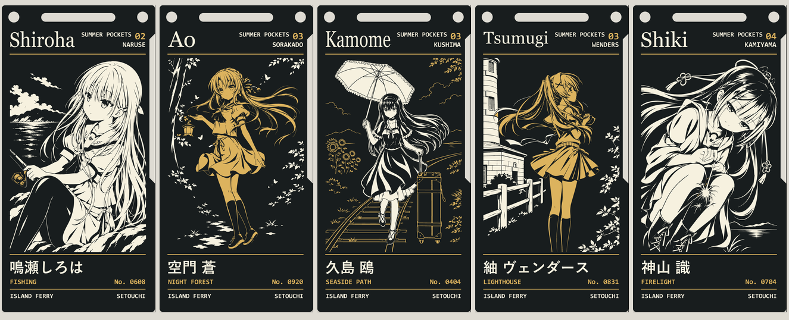

# Summer Pockets · Setouchi Birthday Ferry Tickets

[简体中文](README.md) · [English](README.en.md) · [日本語](README.ja.md)

Each heroine has four birthday ticket designs, each available as a double-sided black-and-white or black-and-gold board. ImageGen inked each illustration from its official full-colour character or event artwork. The character pages show both sides, link the originals and provide the fabrication files.

| Character | Birthday / serial | Route · vessel |
| --- | --- | --- |
| [Shiroha Naruse](birthday-tickets/shiroha/README.en.md) | 06.08 / `0608` | 高松 → 直島・宮浦 · あさひ |
| [Ao Sorakado](birthday-tickets/ao/README.en.md) | 09.20 / `0920` | 高松 → 直島・宮浦 · あさひ |
| [Kamome Kushima](birthday-tickets/kamome/README.en.md) | 04.04 / `0404` | 高松 → 直島・宮浦 · あさひ |
| [Tsumugi Wenders](birthday-tickets/tsumugi/README.en.md) | 08.31 / `0831` | 高松 → 直島・宮浦 · あさひ |
| [Shiki Kamiyama](birthday-tickets/shiki/README.en.md) | 07.04 / `0704` | 高松 → 女木島 · めおん |

## Back

## Shiroha game portrait · original seven

[Original seven](shiroha-classic/README.en.md) · [Blue Sky 1007 special](blue-sky-1007/README.en.md)

## Fabrication

Extract the character bundle and upload one design’s Gerber ZIP. Use two-layer FR-4, 1.6 mm, 1 oz, black mask, white silkscreen and ENIG. All six artwork layers were checked against the native projects. Fine hair and eye detail still need a physical sample.

## Credits and licence

[Kurisu ENIG PCB v1.0.0](https://github.com/observer0703/-kurisu-enig-pcb/releases/tag/v1.0.0) · [ENIG PCB Art](https://github.com/adenzhou1350/enig-pcb-art)

[Key](https://key.visualarts.gr.jp/summer_rb/gallery.html) · [TV Anime](https://summerpockets-anime.jp/) · [Original](birthday-tickets/art-sources.json) · [NOTICE](NOTICE.md) · [CERN-OHL-P-2.0](LICENSE)
