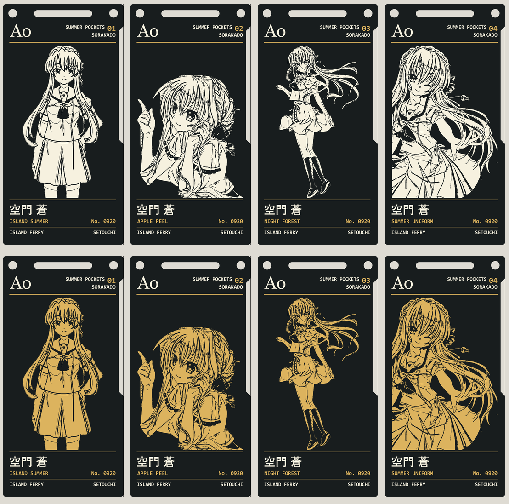
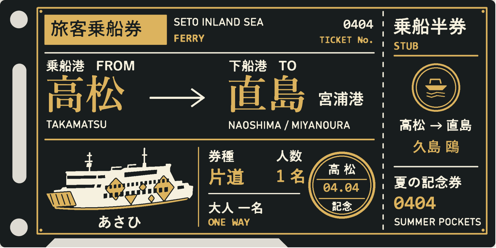
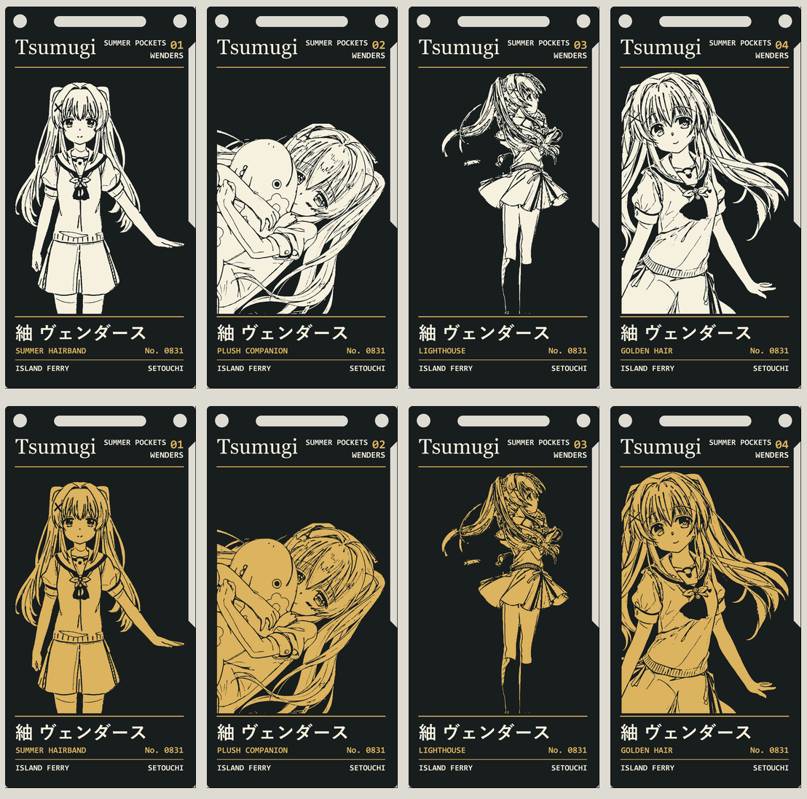

# Summer Pockets · Birthday Ferry Tickets

[简体中文](README.md) · [English](README.en.md) · [日本語](README.ja.md)

Five heroines, four illustrations per heroine and two finishes per illustration give 40 double-sided boards. The front, ticket header and stub carry the four-digit MMDD birthday serial. The back postmark shows the month and day.

| Character | Birthday / ticket | Route and vessel | 8 Gerber sets |
| --- | --- | --- | --- |
| 鳴瀬しろは | [06.08](<https://key.visualarts.gr.jp/archives/6880>) / `0608` | 高松 → 直島・宮浦 · あさひ | [ZIP](https://raw.githubusercontent.com/shiroha777777/shiroha-ferry-pcb/refs/heads/summer-pockets-birthday-tickets/birthday-tickets/shiroha/shiroha-0608-8-gerbers.zip) |
| 空門 蒼 | [09.20](<https://prtimes.jp/main/html/rd/p/000000060.000147227.html>) / `0920` | 高松 → 直島・宮浦 · あさひ | [ZIP](https://raw.githubusercontent.com/shiroha777777/shiroha-ferry-pcb/refs/heads/summer-pockets-birthday-tickets/birthday-tickets/ao/ao-0920-8-gerbers.zip) |
| 久島 鴎 | [04.04](<https://key.visualarts.gr.jp/archives/7444>) / `0404` | 高松 → 直島・宮浦 · あさひ | [ZIP](https://raw.githubusercontent.com/shiroha777777/shiroha-ferry-pcb/refs/heads/summer-pockets-birthday-tickets/birthday-tickets/kamome/kamome-0404-8-gerbers.zip) |
| 紬 ヴェンダース | [08.31](<https://summerpockets-anime.jp/>) / `0831` | 高松 → 直島・宮浦 · あさひ | [ZIP](https://raw.githubusercontent.com/shiroha777777/shiroha-ferry-pcb/refs/heads/summer-pockets-birthday-tickets/birthday-tickets/tsumugi/tsumugi-0831-8-gerbers.zip) |
| 神山 識 | [07.04](<https://key.visualarts.gr.jp/archives/6926>) / `0704` | 高松 → 女木島 · めおん | [ZIP](https://raw.githubusercontent.com/shiroha777777/shiroha-ferry-pcb/refs/heads/summer-pockets-birthday-tickets/birthday-tickets/shiki/shiki-0704-8-gerbers.zip) |

Extract a character bundle and upload the individual Gerber ZIP for the chosen board. Specify two-layer FR-4, 1.6 mm, 1 oz copper, black solder mask, white silkscreen and ENIG. Open the editable projects in EasyEDA Pro.

Designs 01–04 run left to right. Black-and-white is on the top row and black-and-gold on the bottom row.

## 鳴瀬しろは

| Design | Black and white | Black and gold |
| --- | --- | --- |
| 01 · Sea Breeze | [Project](birthday-tickets/shiroha/01/black-white/shiroha-0608-01-black-white.epro2) · [Gerber](birthday-tickets/shiroha/01/black-white/shiroha-0608-01-black-white-gerber.zip) | [Project](birthday-tickets/shiroha/01/black-gold/shiroha-0608-01-black-gold.epro2) · [Gerber](birthday-tickets/shiroha/01/black-gold/shiroha-0608-01-black-gold-gerber.zip) |
| 02 · Fishing | [Project](birthday-tickets/shiroha/02/black-white/shiroha-0608-02-black-white.epro2) · [Gerber](birthday-tickets/shiroha/02/black-white/shiroha-0608-02-black-white-gerber.zip) | [Project](birthday-tickets/shiroha/02/black-gold/shiroha-0608-02-black-gold.epro2) · [Gerber](birthday-tickets/shiroha/02/black-gold/shiroha-0608-02-black-gold-gerber.zip) |
| 03 · Forest Stream | [Project](birthday-tickets/shiroha/03/black-white/shiroha-0608-03-black-white.epro2) · [Gerber](birthday-tickets/shiroha/03/black-white/shiroha-0608-03-black-white-gerber.zip) | [Project](birthday-tickets/shiroha/03/black-gold/shiroha-0608-03-black-gold.epro2) · [Gerber](birthday-tickets/shiroha/03/black-gold/shiroha-0608-03-black-gold-gerber.zip) |
| 04 · Underwater | [Project](birthday-tickets/shiroha/04/black-white/shiroha-0608-04-black-white.epro2) · [Gerber](birthday-tickets/shiroha/04/black-white/shiroha-0608-04-black-white-gerber.zip) | [Project](birthday-tickets/shiroha/04/black-gold/shiroha-0608-04-black-gold.epro2) · [Gerber](birthday-tickets/shiroha/04/black-gold/shiroha-0608-04-black-gold-gerber.zip) |

## 空門 蒼

| Design | Black and white | Black and gold |
| --- | --- | --- |
| 01 · Island Summer | [Project](birthday-tickets/ao/01/black-white/ao-0920-01-black-white.epro2) · [Gerber](birthday-tickets/ao/01/black-white/ao-0920-01-black-white-gerber.zip) | [Project](birthday-tickets/ao/01/black-gold/ao-0920-01-black-gold.epro2) · [Gerber](birthday-tickets/ao/01/black-gold/ao-0920-01-black-gold-gerber.zip) |
| 02 · Apple Peel | [Project](birthday-tickets/ao/02/black-white/ao-0920-02-black-white.epro2) · [Gerber](birthday-tickets/ao/02/black-white/ao-0920-02-black-white-gerber.zip) | [Project](birthday-tickets/ao/02/black-gold/ao-0920-02-black-gold.epro2) · [Gerber](birthday-tickets/ao/02/black-gold/ao-0920-02-black-gold-gerber.zip) |
| 03 · Night Forest | [Project](birthday-tickets/ao/03/black-white/ao-0920-03-black-white.epro2) · [Gerber](birthday-tickets/ao/03/black-white/ao-0920-03-black-white-gerber.zip) | [Project](birthday-tickets/ao/03/black-gold/ao-0920-03-black-gold.epro2) · [Gerber](birthday-tickets/ao/03/black-gold/ao-0920-03-black-gold-gerber.zip) |
| 04 · Summer Uniform | [Project](birthday-tickets/ao/04/black-white/ao-0920-04-black-white.epro2) · [Gerber](birthday-tickets/ao/04/black-white/ao-0920-04-black-white-gerber.zip) | [Project](birthday-tickets/ao/04/black-gold/ao-0920-04-black-gold.epro2) · [Gerber](birthday-tickets/ao/04/black-gold/ao-0920-04-black-gold-gerber.zip) |

## 久島 鴎

| Design | Black and white | Black and gold |
| --- | --- | --- |
| 01 · Summer Dress | [Project](birthday-tickets/kamome/01/black-white/kamome-0404-01-black-white.epro2) · [Gerber](birthday-tickets/kamome/01/black-white/kamome-0404-01-black-white-gerber.zip) | [Project](birthday-tickets/kamome/01/black-gold/kamome-0404-01-black-gold.epro2) · [Gerber](birthday-tickets/kamome/01/black-gold/kamome-0404-01-black-gold-gerber.zip) |
| 02 · Under the Parasol | [Project](birthday-tickets/kamome/02/black-white/kamome-0404-02-black-white.epro2) · [Gerber](birthday-tickets/kamome/02/black-white/kamome-0404-02-black-white-gerber.zip) | [Project](birthday-tickets/kamome/02/black-gold/kamome-0404-02-black-gold.epro2) · [Gerber](birthday-tickets/kamome/02/black-gold/kamome-0404-02-black-gold-gerber.zip) |
| 03 · Seaside Path | [Project](birthday-tickets/kamome/03/black-white/kamome-0404-03-black-white.epro2) · [Gerber](birthday-tickets/kamome/03/black-white/kamome-0404-03-black-white-gerber.zip) | [Project](birthday-tickets/kamome/03/black-gold/kamome-0404-03-black-gold.epro2) · [Gerber](birthday-tickets/kamome/03/black-gold/kamome-0404-03-black-gold-gerber.zip) |
| 04 · Travel Trunk | [Project](birthday-tickets/kamome/04/black-white/kamome-0404-04-black-white.epro2) · [Gerber](birthday-tickets/kamome/04/black-white/kamome-0404-04-black-white-gerber.zip) | [Project](birthday-tickets/kamome/04/black-gold/kamome-0404-04-black-gold.epro2) · [Gerber](birthday-tickets/kamome/04/black-gold/kamome-0404-04-black-gold-gerber.zip) |

## 紬 ヴェンダース

| Design | Black and white | Black and gold |
| --- | --- | --- |
| 01 · Summer Hairband | [Project](birthday-tickets/tsumugi/01/black-white/tsumugi-0831-01-black-white.epro2) · [Gerber](birthday-tickets/tsumugi/01/black-white/tsumugi-0831-01-black-white-gerber.zip) | [Project](birthday-tickets/tsumugi/01/black-gold/tsumugi-0831-01-black-gold.epro2) · [Gerber](birthday-tickets/tsumugi/01/black-gold/tsumugi-0831-01-black-gold-gerber.zip) |
| 02 · Plush Companion | [Project](birthday-tickets/tsumugi/02/black-white/tsumugi-0831-02-black-white.epro2) · [Gerber](birthday-tickets/tsumugi/02/black-white/tsumugi-0831-02-black-white-gerber.zip) | [Project](birthday-tickets/tsumugi/02/black-gold/tsumugi-0831-02-black-gold.epro2) · [Gerber](birthday-tickets/tsumugi/02/black-gold/tsumugi-0831-02-black-gold-gerber.zip) |
| 03 · Lighthouse | [Project](birthday-tickets/tsumugi/03/black-white/tsumugi-0831-03-black-white.epro2) · [Gerber](birthday-tickets/tsumugi/03/black-white/tsumugi-0831-03-black-white-gerber.zip) | [Project](birthday-tickets/tsumugi/03/black-gold/tsumugi-0831-03-black-gold.epro2) · [Gerber](birthday-tickets/tsumugi/03/black-gold/tsumugi-0831-03-black-gold-gerber.zip) |
| 04 · Golden Hair | [Project](birthday-tickets/tsumugi/04/black-white/tsumugi-0831-04-black-white.epro2) · [Gerber](birthday-tickets/tsumugi/04/black-white/tsumugi-0831-04-black-white-gerber.zip) | [Project](birthday-tickets/tsumugi/04/black-gold/tsumugi-0831-04-black-gold.epro2) · [Gerber](birthday-tickets/tsumugi/04/black-gold/tsumugi-0831-04-black-gold-gerber.zip) |

## 神山 識

| Design | Black and white | Black and gold |
| --- | --- | --- |
| 01 · Oni Hood | [Project](birthday-tickets/shiki/01/black-white/shiki-0704-01-black-white.epro2) · [Gerber](birthday-tickets/shiki/01/black-white/shiki-0704-01-black-white-gerber.zip) | [Project](birthday-tickets/shiki/01/black-gold/shiki-0704-01-black-gold.epro2) · [Gerber](birthday-tickets/shiki/01/black-gold/shiki-0704-01-black-gold-gerber.zip) |
| 02 · Summer Leap | [Project](birthday-tickets/shiki/02/black-white/shiki-0704-02-black-white.epro2) · [Gerber](birthday-tickets/shiki/02/black-white/shiki-0704-02-black-white-gerber.zip) | [Project](birthday-tickets/shiki/02/black-gold/shiki-0704-02-black-gold.epro2) · [Gerber](birthday-tickets/shiki/02/black-gold/shiki-0704-02-black-gold-gerber.zip) |
| 03 · Floating Lanterns | [Project](birthday-tickets/shiki/03/black-white/shiki-0704-03-black-white.epro2) · [Gerber](birthday-tickets/shiki/03/black-white/shiki-0704-03-black-white-gerber.zip) | [Project](birthday-tickets/shiki/03/black-gold/shiki-0704-03-black-gold.epro2) · [Gerber](birthday-tickets/shiki/03/black-gold/shiki-0704-03-black-gold-gerber.zip) |
| 04 · Firelight | [Project](birthday-tickets/shiki/04/black-white/shiki-0704-04-black-white.epro2) · [Gerber](birthday-tickets/shiki/04/black-white/shiki-0704-04-black-white-gerber.zip) | [Project](birthday-tickets/shiki/04/black-gold/shiki-0704-04-black-gold.epro2) · [Gerber](birthday-tickets/shiki/04/black-gold/shiki-0704-04-black-gold-gerber.zip) |

## Verification and sources

The six manufacturing layers in each native project were checked point by point against its Gerbers, along with mask openings, outline and drills. Factory CAM acceptance and physical samples are pending. Fine hairlines and engraved shadows need sample inspection.

[鳴瀬しろは](birthday-tickets/shiroha/verification.json) · [空門 蒼](birthday-tickets/ao/verification.json) · [久島 鴎](birthday-tickets/kamome/verification.json) · [紬 ヴェンダース](birthday-tickets/tsumugi/verification.json) · [神山 識](birthday-tickets/shiki/verification.json)

[Illustration sources](birthday-tickets/art-sources.json) · [Key](https://key.visualarts.gr.jp/summer_rb/gallery.html) · [TV Anime](https://summerpockets-anime.jp/)

Vessel references · [四国汽船](https://www.shikokukisen.com/) · [雌雄島海運](https://meon.co.jp/access#ship)

## References and license

Design references · [observer0703 / Kurisu ENIG PCB v1.0.0](https://github.com/observer0703/-kurisu-enig-pcb/releases/tag/v1.0.0) · [adenzhou1350 / ENIG PCB Art](https://github.com/adenzhou1350/enig-pcb-art)

[CERN-OHL-P-2.0](LICENSE) · [NOTICE](NOTICE.md) · [Main collection](https://github.com/shiroha777777/shiroha-ferry-pcb/blob/main/README.en.md)
