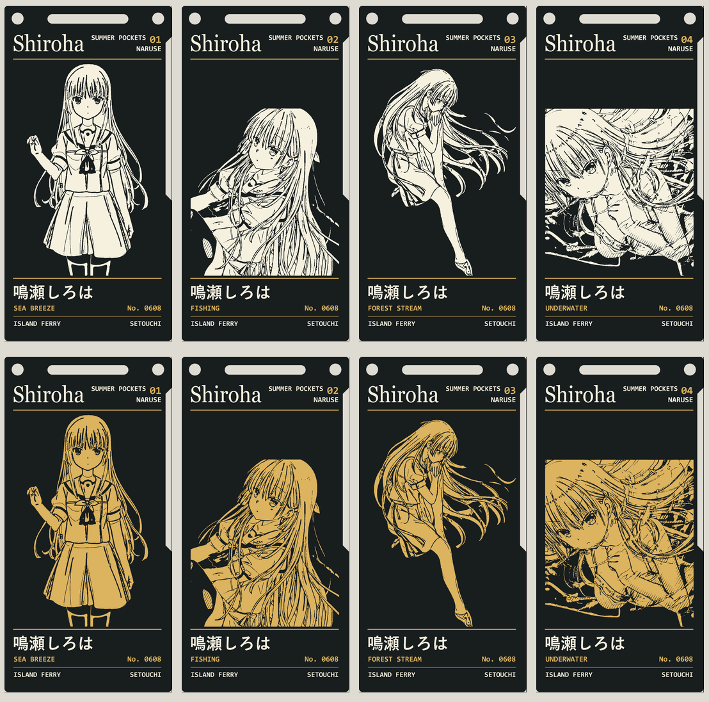
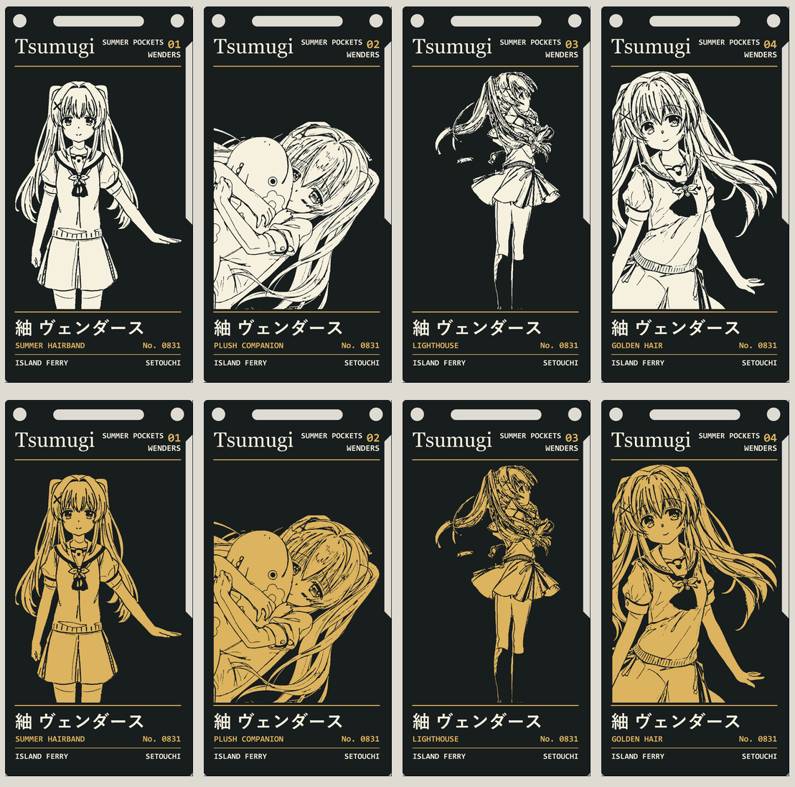
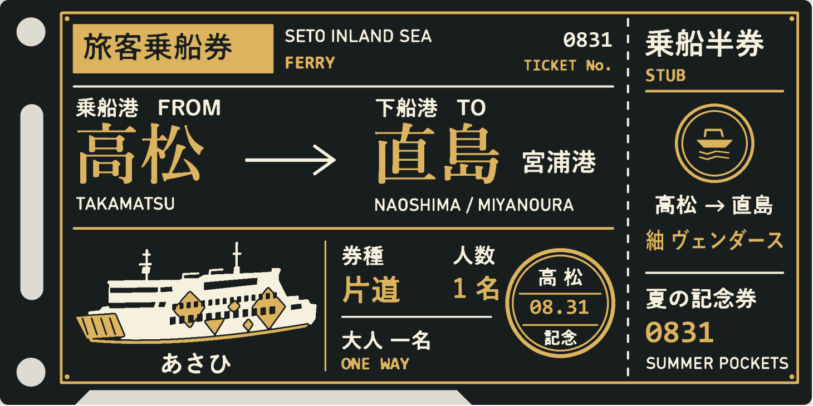

# Summer Pockets · 5 人の誕生日乗船券 PCB

[简体中文](README.md) · [English](README.en.md) · [日本語](README.ja.md)

5 人のヒロインに各 4 種の図柄を用意しました。それぞれ白黒版と黒金版があり、合計 40 種類の両面基板です。表面、裏面の券面上部、半券には誕生日を表す 4 桁の番号を入れ、記念印には月日を刻んでいます。

| キャラクター | 誕生日／券番号 | 航路・船名 | 製造データ 8 種 |
| --- | --- | --- | --- |
| 鳴瀬しろは | [06.08](<https://key.visualarts.gr.jp/archives/6880>) / `0608` | 高松 → 直島・宮浦 · あさひ | [ZIP](https://raw.githubusercontent.com/shiroha777777/shiroha-ferry-pcb/refs/heads/summer-pockets-birthday-tickets/birthday-tickets/shiroha/shiroha-0608-8-gerbers.zip) |
| 空門 蒼 | [09.20](<https://prtimes.jp/main/html/rd/p/000000060.000147227.html>) / `0920` | 高松 → 直島・宮浦 · あさひ | [ZIP](https://raw.githubusercontent.com/shiroha777777/shiroha-ferry-pcb/refs/heads/summer-pockets-birthday-tickets/birthday-tickets/ao/ao-0920-8-gerbers.zip) |
| 久島 鴎 | [04.04](<https://key.visualarts.gr.jp/archives/7444>) / `0404` | 高松 → 直島・宮浦 · あさひ | [ZIP](https://raw.githubusercontent.com/shiroha777777/shiroha-ferry-pcb/refs/heads/summer-pockets-birthday-tickets/birthday-tickets/kamome/kamome-0404-8-gerbers.zip) |
| 紬 ヴェンダース | [08.31](<https://summerpockets-anime.jp/>) / `0831` | 高松 → 直島・宮浦 · あさひ | [ZIP](https://raw.githubusercontent.com/shiroha777777/shiroha-ferry-pcb/refs/heads/summer-pockets-birthday-tickets/birthday-tickets/tsumugi/tsumugi-0831-8-gerbers.zip) |
| 神山 識 | [07.04](<https://key.visualarts.gr.jp/archives/6926>) / `0704` | 高松 → 女木島 · めおん | [ZIP](https://raw.githubusercontent.com/shiroha777777/shiroha-ferry-pcb/refs/heads/summer-pockets-birthday-tickets/birthday-tickets/shiki/shiki-0704-8-gerbers.zip) |

各キャラクターの一式を展開し、希望する基板の Gerber ZIP を 1 つ選んで発注してください。仕様は FR-4、2 層、板厚 1.6 mm、銅厚 1 oz、黒レジスト、白シルク、ENIG です。プロジェクトは EasyEDA Pro で開けます。

各画像は左から 01〜04 の順です。上段が白黒版、下段が黒金版です。

## 鳴瀬しろは

| 図柄 | 白黒版 | 黒金版 |
| --- | --- | --- |
| 01 · Sea Breeze | [プロジェクト](birthday-tickets/shiroha/01/black-white/shiroha-0608-01-black-white.epro2) · [Gerber](birthday-tickets/shiroha/01/black-white/shiroha-0608-01-black-white-gerber.zip) | [プロジェクト](birthday-tickets/shiroha/01/black-gold/shiroha-0608-01-black-gold.epro2) · [Gerber](birthday-tickets/shiroha/01/black-gold/shiroha-0608-01-black-gold-gerber.zip) |
| 02 · Fishing | [プロジェクト](birthday-tickets/shiroha/02/black-white/shiroha-0608-02-black-white.epro2) · [Gerber](birthday-tickets/shiroha/02/black-white/shiroha-0608-02-black-white-gerber.zip) | [プロジェクト](birthday-tickets/shiroha/02/black-gold/shiroha-0608-02-black-gold.epro2) · [Gerber](birthday-tickets/shiroha/02/black-gold/shiroha-0608-02-black-gold-gerber.zip) |
| 03 · Forest Stream | [プロジェクト](birthday-tickets/shiroha/03/black-white/shiroha-0608-03-black-white.epro2) · [Gerber](birthday-tickets/shiroha/03/black-white/shiroha-0608-03-black-white-gerber.zip) | [プロジェクト](birthday-tickets/shiroha/03/black-gold/shiroha-0608-03-black-gold.epro2) · [Gerber](birthday-tickets/shiroha/03/black-gold/shiroha-0608-03-black-gold-gerber.zip) |
| 04 · Underwater | [プロジェクト](birthday-tickets/shiroha/04/black-white/shiroha-0608-04-black-white.epro2) · [Gerber](birthday-tickets/shiroha/04/black-white/shiroha-0608-04-black-white-gerber.zip) | [プロジェクト](birthday-tickets/shiroha/04/black-gold/shiroha-0608-04-black-gold.epro2) · [Gerber](birthday-tickets/shiroha/04/black-gold/shiroha-0608-04-black-gold-gerber.zip) |

## 空門 蒼

| 図柄 | 白黒版 | 黒金版 |
| --- | --- | --- |
| 01 · Island Summer | [プロジェクト](birthday-tickets/ao/01/black-white/ao-0920-01-black-white.epro2) · [Gerber](birthday-tickets/ao/01/black-white/ao-0920-01-black-white-gerber.zip) | [プロジェクト](birthday-tickets/ao/01/black-gold/ao-0920-01-black-gold.epro2) · [Gerber](birthday-tickets/ao/01/black-gold/ao-0920-01-black-gold-gerber.zip) |
| 02 · Apple Peel | [プロジェクト](birthday-tickets/ao/02/black-white/ao-0920-02-black-white.epro2) · [Gerber](birthday-tickets/ao/02/black-white/ao-0920-02-black-white-gerber.zip) | [プロジェクト](birthday-tickets/ao/02/black-gold/ao-0920-02-black-gold.epro2) · [Gerber](birthday-tickets/ao/02/black-gold/ao-0920-02-black-gold-gerber.zip) |
| 03 · Night Forest | [プロジェクト](birthday-tickets/ao/03/black-white/ao-0920-03-black-white.epro2) · [Gerber](birthday-tickets/ao/03/black-white/ao-0920-03-black-white-gerber.zip) | [プロジェクト](birthday-tickets/ao/03/black-gold/ao-0920-03-black-gold.epro2) · [Gerber](birthday-tickets/ao/03/black-gold/ao-0920-03-black-gold-gerber.zip) |
| 04 · Summer Uniform | [プロジェクト](birthday-tickets/ao/04/black-white/ao-0920-04-black-white.epro2) · [Gerber](birthday-tickets/ao/04/black-white/ao-0920-04-black-white-gerber.zip) | [プロジェクト](birthday-tickets/ao/04/black-gold/ao-0920-04-black-gold.epro2) · [Gerber](birthday-tickets/ao/04/black-gold/ao-0920-04-black-gold-gerber.zip) |

## 久島 鴎

| 図柄 | 白黒版 | 黒金版 |
| --- | --- | --- |
| 01 · Summer Dress | [プロジェクト](birthday-tickets/kamome/01/black-white/kamome-0404-01-black-white.epro2) · [Gerber](birthday-tickets/kamome/01/black-white/kamome-0404-01-black-white-gerber.zip) | [プロジェクト](birthday-tickets/kamome/01/black-gold/kamome-0404-01-black-gold.epro2) · [Gerber](birthday-tickets/kamome/01/black-gold/kamome-0404-01-black-gold-gerber.zip) |
| 02 · Under the Parasol | [プロジェクト](birthday-tickets/kamome/02/black-white/kamome-0404-02-black-white.epro2) · [Gerber](birthday-tickets/kamome/02/black-white/kamome-0404-02-black-white-gerber.zip) | [プロジェクト](birthday-tickets/kamome/02/black-gold/kamome-0404-02-black-gold.epro2) · [Gerber](birthday-tickets/kamome/02/black-gold/kamome-0404-02-black-gold-gerber.zip) |
| 03 · Seaside Path | [プロジェクト](birthday-tickets/kamome/03/black-white/kamome-0404-03-black-white.epro2) · [Gerber](birthday-tickets/kamome/03/black-white/kamome-0404-03-black-white-gerber.zip) | [プロジェクト](birthday-tickets/kamome/03/black-gold/kamome-0404-03-black-gold.epro2) · [Gerber](birthday-tickets/kamome/03/black-gold/kamome-0404-03-black-gold-gerber.zip) |
| 04 · Travel Trunk | [プロジェクト](birthday-tickets/kamome/04/black-white/kamome-0404-04-black-white.epro2) · [Gerber](birthday-tickets/kamome/04/black-white/kamome-0404-04-black-white-gerber.zip) | [プロジェクト](birthday-tickets/kamome/04/black-gold/kamome-0404-04-black-gold.epro2) · [Gerber](birthday-tickets/kamome/04/black-gold/kamome-0404-04-black-gold-gerber.zip) |

## 紬 ヴェンダース

| 図柄 | 白黒版 | 黒金版 |
| --- | --- | --- |
| 01 · Summer Hairband | [プロジェクト](birthday-tickets/tsumugi/01/black-white/tsumugi-0831-01-black-white.epro2) · [Gerber](birthday-tickets/tsumugi/01/black-white/tsumugi-0831-01-black-white-gerber.zip) | [プロジェクト](birthday-tickets/tsumugi/01/black-gold/tsumugi-0831-01-black-gold.epro2) · [Gerber](birthday-tickets/tsumugi/01/black-gold/tsumugi-0831-01-black-gold-gerber.zip) |
| 02 · Plush Companion | [プロジェクト](birthday-tickets/tsumugi/02/black-white/tsumugi-0831-02-black-white.epro2) · [Gerber](birthday-tickets/tsumugi/02/black-white/tsumugi-0831-02-black-white-gerber.zip) | [プロジェクト](birthday-tickets/tsumugi/02/black-gold/tsumugi-0831-02-black-gold.epro2) · [Gerber](birthday-tickets/tsumugi/02/black-gold/tsumugi-0831-02-black-gold-gerber.zip) |
| 03 · Lighthouse | [プロジェクト](birthday-tickets/tsumugi/03/black-white/tsumugi-0831-03-black-white.epro2) · [Gerber](birthday-tickets/tsumugi/03/black-white/tsumugi-0831-03-black-white-gerber.zip) | [プロジェクト](birthday-tickets/tsumugi/03/black-gold/tsumugi-0831-03-black-gold.epro2) · [Gerber](birthday-tickets/tsumugi/03/black-gold/tsumugi-0831-03-black-gold-gerber.zip) |
| 04 · Golden Hair | [プロジェクト](birthday-tickets/tsumugi/04/black-white/tsumugi-0831-04-black-white.epro2) · [Gerber](birthday-tickets/tsumugi/04/black-white/tsumugi-0831-04-black-white-gerber.zip) | [プロジェクト](birthday-tickets/tsumugi/04/black-gold/tsumugi-0831-04-black-gold.epro2) · [Gerber](birthday-tickets/tsumugi/04/black-gold/tsumugi-0831-04-black-gold-gerber.zip) |

## 神山 識

| 図柄 | 白黒版 | 黒金版 |
| --- | --- | --- |
| 01 · Oni Hood | [プロジェクト](birthday-tickets/shiki/01/black-white/shiki-0704-01-black-white.epro2) · [Gerber](birthday-tickets/shiki/01/black-white/shiki-0704-01-black-white-gerber.zip) | [プロジェクト](birthday-tickets/shiki/01/black-gold/shiki-0704-01-black-gold.epro2) · [Gerber](birthday-tickets/shiki/01/black-gold/shiki-0704-01-black-gold-gerber.zip) |
| 02 · Summer Leap | [プロジェクト](birthday-tickets/shiki/02/black-white/shiki-0704-02-black-white.epro2) · [Gerber](birthday-tickets/shiki/02/black-white/shiki-0704-02-black-white-gerber.zip) | [プロジェクト](birthday-tickets/shiki/02/black-gold/shiki-0704-02-black-gold.epro2) · [Gerber](birthday-tickets/shiki/02/black-gold/shiki-0704-02-black-gold-gerber.zip) |
| 03 · Floating Lanterns | [プロジェクト](birthday-tickets/shiki/03/black-white/shiki-0704-03-black-white.epro2) · [Gerber](birthday-tickets/shiki/03/black-white/shiki-0704-03-black-white-gerber.zip) | [プロジェクト](birthday-tickets/shiki/03/black-gold/shiki-0704-03-black-gold.epro2) · [Gerber](birthday-tickets/shiki/03/black-gold/shiki-0704-03-black-gold-gerber.zip) |
| 04 · Firelight | [プロジェクト](birthday-tickets/shiki/04/black-white/shiki-0704-04-black-white.epro2) · [Gerber](birthday-tickets/shiki/04/black-white/shiki-0704-04-black-white-gerber.zip) | [プロジェクト](birthday-tickets/shiki/04/black-gold/shiki-0704-04-black-gold.epro2) · [Gerber](birthday-tickets/shiki/04/black-gold/shiki-0704-04-black-gold-gerber.zip) |

## 検証・出典

各プロジェクトの 6 製造レイヤーを Gerber と点ごとに照合し、レジスト開口、基板外形、ドリルも確認しました。工場での CAM 確認と実物の評価はこれからです。細い髪や陰影の線は実物での確認が必要です。

[鳴瀬しろは](birthday-tickets/shiroha/verification.json) · [空門 蒼](birthday-tickets/ao/verification.json) · [久島 鴎](birthday-tickets/kamome/verification.json) · [紬 ヴェンダース](birthday-tickets/tsumugi/verification.json) · [神山 識](birthday-tickets/shiki/verification.json)

[イラスト出典](birthday-tickets/art-sources.json) · [Key](https://key.visualarts.gr.jp/summer_rb/gallery.html) · [TV Anime](https://summerpockets-anime.jp/)

船舶資料 · [四国汽船](https://www.shikokukisen.com/) · [雌雄島海運](https://meon.co.jp/access#ship)

## 参考資料とライセンス

設計参考 · [observer0703 / Kurisu ENIG PCB v1.0.0](https://github.com/observer0703/-kurisu-enig-pcb/releases/tag/v1.0.0) · [adenzhou1350 / ENIG PCB Art](https://github.com/adenzhou1350/enig-pcb-art)

[CERN-OHL-P-2.0](LICENSE) · [NOTICE](NOTICE.md) · [通常版](https://github.com/shiroha777777/shiroha-ferry-pcb/blob/main/README.ja.md)
