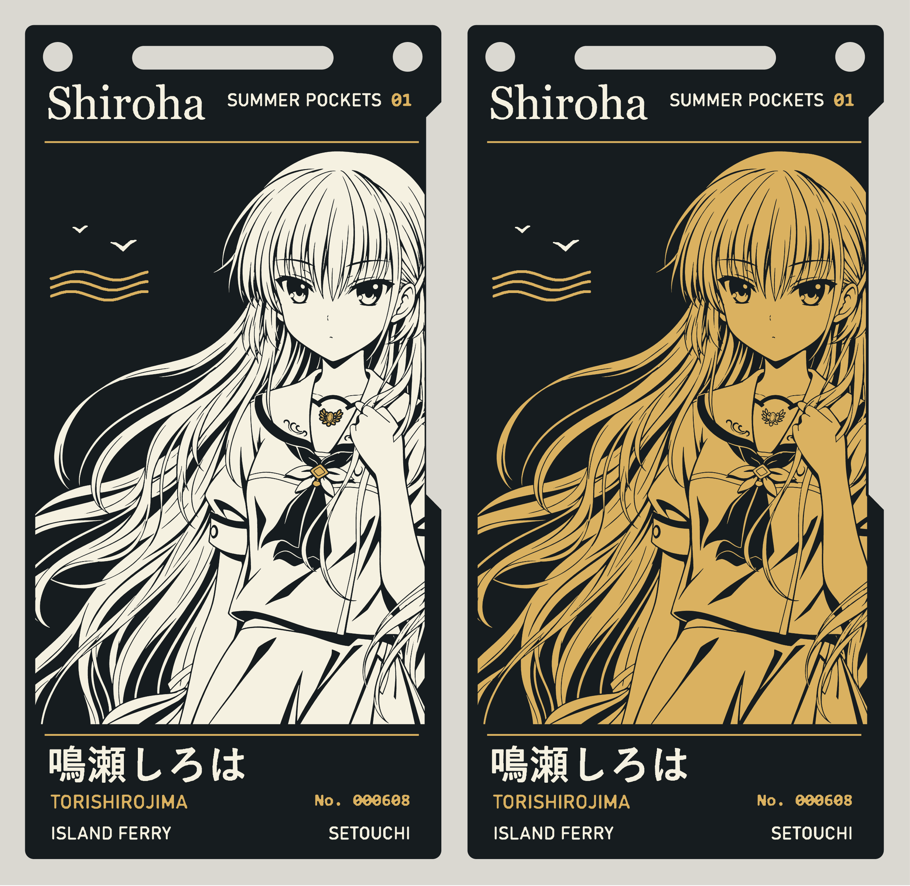

# Summer Pockets · 濑户内生日船票 PCB

[简体中文](README.md) · [English](README.en.md) · [日本語](README.ja.md)

白羽收录 9 款生日票，空门苍 5 款，久岛鸥、紬和神山识各 4 款，共 26 款、52 套双面工程。各角色页提供黑白与黑金预览、背板和打板文件。

白羽、苍、紬和识采用游戏官方立绘，鸥采用电视动画官方立绘。

正面右上角的两位数按角色固定，同一角色的所有款式与配色共用。

| 角色编号 | 角色 | 生日 / 票号 | 航线 · 船名 |
| --- | --- | --- | --- |
| `01` | [鳴瀬しろは](birthday-tickets/shiroha/README.md) | 06.08 / `0608` | 高松 → 直島・宮浦 · あさひ |
| `02` | [空門 蒼](birthday-tickets/ao/README.md) | 09.20 / `0920` | 高松 → 直島・宮浦 · あさひ |
| `03` | [久島 鴎](birthday-tickets/kamome/README.md) | 04.04 / `0404` | 高松 → 直島・宮浦 · あさひ |
| `04` | [紬 ヴェンダース](birthday-tickets/tsumugi/README.md) | 08.31 / `0831` | 高松 → 直島・宮浦 · あさひ |
| `05` | [神山 識](birthday-tickets/shiki/README.md) | 07.04 / `0704` | 高松 → 女木島 · めおん |

## 背面

## 白羽游戏立绘

[白羽全部九款](birthday-tickets/shiroha/README.md) · [蓝天 1007 特别版](blue-sky-1007/README.md)

## 制板

解压角色合集后，选一款 Gerber ZIP 上传嘉立创。双层 FR-4，板厚 1.6 mm，1 oz，黑阻焊、白丝印、沉金。六个图形层已与工程逐点核对，精细发丝和眼部仍需实板验证。

## 参考与许可

[Kurisu ENIG PCB v1.0.0](https://github.com/observer0703/-kurisu-enig-pcb/releases/tag/v1.0.0) · [ENIG PCB Art](https://github.com/adenzhou1350/enig-pcb-art)

[Key](https://key.visualarts.gr.jp/summer_rb/gallery.html) · [TV Anime](https://summerpockets-anime.jp/) · [原画](birthday-tickets/art-sources.json) · [NOTICE](NOTICE.md) · [CERN-OHL-P-2.0](LICENSE)
