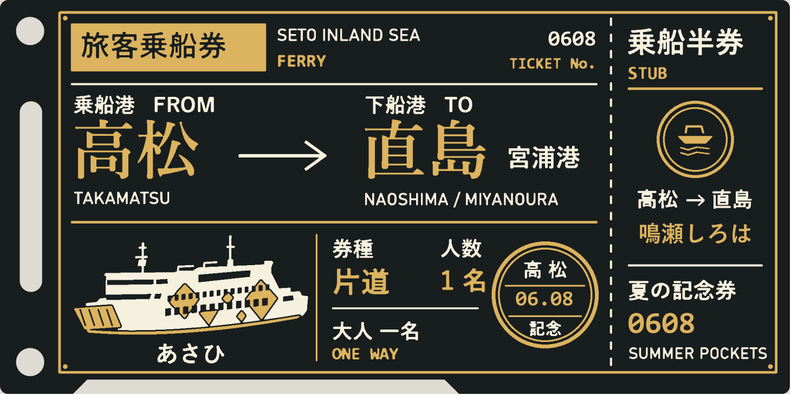
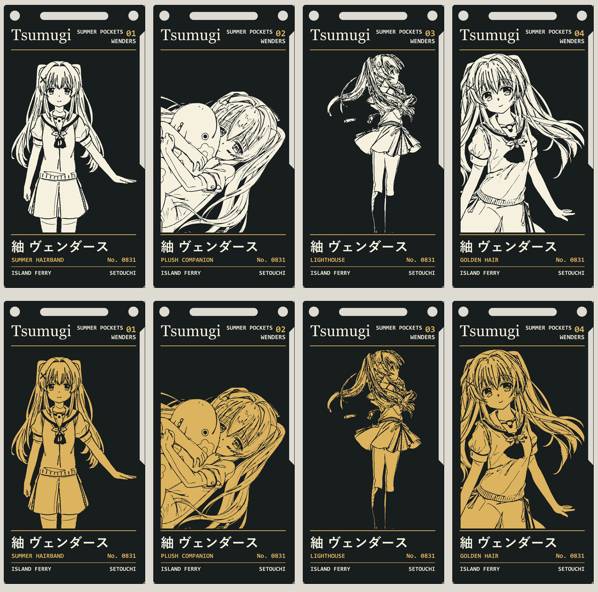
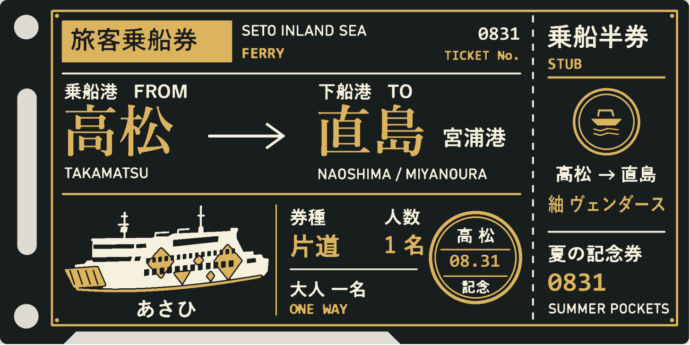

# Summer Pockets · 五人生日船票 PCB

[简体中文](README.md) · [English](README.en.md) · [日本語](README.ja.md)

五位角色各有四张画稿，每张提供黑白和黑金两版，共 40 套双面 PCB。每张票的正面、背面票头和票根使用四位生日编号，背面纪念章使用月、日。

| 角色 | 生日／票号 | 航线与船名 | 8 套打板文件 |
| --- | --- | --- | --- |
| 鳴瀬しろは | [06.08](<https://key.visualarts.gr.jp/archives/6880>) / `0608` | 高松 → 直島・宮浦 · あさひ | [ZIP](https://raw.githubusercontent.com/shiroha777777/shiroha-ferry-pcb/refs/heads/summer-pockets-birthday-tickets/birthday-tickets/shiroha/shiroha-0608-8-gerbers.zip) |
| 空門 蒼 | [09.20](<https://prtimes.jp/main/html/rd/p/000000060.000147227.html>) / `0920` | 高松 → 直島・宮浦 · あさひ | [ZIP](https://raw.githubusercontent.com/shiroha777777/shiroha-ferry-pcb/refs/heads/summer-pockets-birthday-tickets/birthday-tickets/ao/ao-0920-8-gerbers.zip) |
| 久島 鴎 | [04.04](<https://key.visualarts.gr.jp/archives/7444>) / `0404` | 高松 → 直島・宮浦 · あさひ | [ZIP](https://raw.githubusercontent.com/shiroha777777/shiroha-ferry-pcb/refs/heads/summer-pockets-birthday-tickets/birthday-tickets/kamome/kamome-0404-8-gerbers.zip) |
| 紬 ヴェンダース | [08.31](<https://summerpockets-anime.jp/>) / `0831` | 高松 → 直島・宮浦 · あさひ | [ZIP](https://raw.githubusercontent.com/shiroha777777/shiroha-ferry-pcb/refs/heads/summer-pockets-birthday-tickets/birthday-tickets/tsumugi/tsumugi-0831-8-gerbers.zip) |
| 神山 識 | [07.04](<https://key.visualarts.gr.jp/archives/6926>) / `0704` | 高松 → 女木島 · めおん | [ZIP](https://raw.githubusercontent.com/shiroha777777/shiroha-ferry-pcb/refs/heads/summer-pockets-birthday-tickets/birthday-tickets/shiki/shiki-0704-8-gerbers.zip) |

打板时解压角色合集，选择一款的 Gerber ZIP 上传。板材为双层 FR-4，板厚 1.6 mm、铜厚 1 oz，黑阻焊、白丝印、沉金。工程可用嘉立创 EDA 专业版打开。

图中从左到右为 01–04 款。上排为黑白，下排为黑金。

## 鳴瀬しろは

| 款式 | 黑白 | 黑金 |
| --- | --- | --- |
| 01 · Sea Breeze | [工程](birthday-tickets/shiroha/01/black-white/shiroha-0608-01-black-white.epro2) · [Gerber](birthday-tickets/shiroha/01/black-white/shiroha-0608-01-black-white-gerber.zip) | [工程](birthday-tickets/shiroha/01/black-gold/shiroha-0608-01-black-gold.epro2) · [Gerber](birthday-tickets/shiroha/01/black-gold/shiroha-0608-01-black-gold-gerber.zip) |
| 02 · Fishing | [工程](birthday-tickets/shiroha/02/black-white/shiroha-0608-02-black-white.epro2) · [Gerber](birthday-tickets/shiroha/02/black-white/shiroha-0608-02-black-white-gerber.zip) | [工程](birthday-tickets/shiroha/02/black-gold/shiroha-0608-02-black-gold.epro2) · [Gerber](birthday-tickets/shiroha/02/black-gold/shiroha-0608-02-black-gold-gerber.zip) |
| 03 · Forest Stream | [工程](birthday-tickets/shiroha/03/black-white/shiroha-0608-03-black-white.epro2) · [Gerber](birthday-tickets/shiroha/03/black-white/shiroha-0608-03-black-white-gerber.zip) | [工程](birthday-tickets/shiroha/03/black-gold/shiroha-0608-03-black-gold.epro2) · [Gerber](birthday-tickets/shiroha/03/black-gold/shiroha-0608-03-black-gold-gerber.zip) |
| 04 · Underwater | [工程](birthday-tickets/shiroha/04/black-white/shiroha-0608-04-black-white.epro2) · [Gerber](birthday-tickets/shiroha/04/black-white/shiroha-0608-04-black-white-gerber.zip) | [工程](birthday-tickets/shiroha/04/black-gold/shiroha-0608-04-black-gold.epro2) · [Gerber](birthday-tickets/shiroha/04/black-gold/shiroha-0608-04-black-gold-gerber.zip) |

## 空門 蒼

| 款式 | 黑白 | 黑金 |
| --- | --- | --- |
| 01 · Island Summer | [工程](birthday-tickets/ao/01/black-white/ao-0920-01-black-white.epro2) · [Gerber](birthday-tickets/ao/01/black-white/ao-0920-01-black-white-gerber.zip) | [工程](birthday-tickets/ao/01/black-gold/ao-0920-01-black-gold.epro2) · [Gerber](birthday-tickets/ao/01/black-gold/ao-0920-01-black-gold-gerber.zip) |
| 02 · Apple Peel | [工程](birthday-tickets/ao/02/black-white/ao-0920-02-black-white.epro2) · [Gerber](birthday-tickets/ao/02/black-white/ao-0920-02-black-white-gerber.zip) | [工程](birthday-tickets/ao/02/black-gold/ao-0920-02-black-gold.epro2) · [Gerber](birthday-tickets/ao/02/black-gold/ao-0920-02-black-gold-gerber.zip) |
| 03 · Night Forest | [工程](birthday-tickets/ao/03/black-white/ao-0920-03-black-white.epro2) · [Gerber](birthday-tickets/ao/03/black-white/ao-0920-03-black-white-gerber.zip) | [工程](birthday-tickets/ao/03/black-gold/ao-0920-03-black-gold.epro2) · [Gerber](birthday-tickets/ao/03/black-gold/ao-0920-03-black-gold-gerber.zip) |
| 04 · Summer Uniform | [工程](birthday-tickets/ao/04/black-white/ao-0920-04-black-white.epro2) · [Gerber](birthday-tickets/ao/04/black-white/ao-0920-04-black-white-gerber.zip) | [工程](birthday-tickets/ao/04/black-gold/ao-0920-04-black-gold.epro2) · [Gerber](birthday-tickets/ao/04/black-gold/ao-0920-04-black-gold-gerber.zip) |

## 久島 鴎

| 款式 | 黑白 | 黑金 |
| --- | --- | --- |
| 01 · Summer Dress | [工程](birthday-tickets/kamome/01/black-white/kamome-0404-01-black-white.epro2) · [Gerber](birthday-tickets/kamome/01/black-white/kamome-0404-01-black-white-gerber.zip) | [工程](birthday-tickets/kamome/01/black-gold/kamome-0404-01-black-gold.epro2) · [Gerber](birthday-tickets/kamome/01/black-gold/kamome-0404-01-black-gold-gerber.zip) |
| 02 · Under the Parasol | [工程](birthday-tickets/kamome/02/black-white/kamome-0404-02-black-white.epro2) · [Gerber](birthday-tickets/kamome/02/black-white/kamome-0404-02-black-white-gerber.zip) | [工程](birthday-tickets/kamome/02/black-gold/kamome-0404-02-black-gold.epro2) · [Gerber](birthday-tickets/kamome/02/black-gold/kamome-0404-02-black-gold-gerber.zip) |
| 03 · Seaside Path | [工程](birthday-tickets/kamome/03/black-white/kamome-0404-03-black-white.epro2) · [Gerber](birthday-tickets/kamome/03/black-white/kamome-0404-03-black-white-gerber.zip) | [工程](birthday-tickets/kamome/03/black-gold/kamome-0404-03-black-gold.epro2) · [Gerber](birthday-tickets/kamome/03/black-gold/kamome-0404-03-black-gold-gerber.zip) |
| 04 · Travel Trunk | [工程](birthday-tickets/kamome/04/black-white/kamome-0404-04-black-white.epro2) · [Gerber](birthday-tickets/kamome/04/black-white/kamome-0404-04-black-white-gerber.zip) | [工程](birthday-tickets/kamome/04/black-gold/kamome-0404-04-black-gold.epro2) · [Gerber](birthday-tickets/kamome/04/black-gold/kamome-0404-04-black-gold-gerber.zip) |

## 紬 ヴェンダース

| 款式 | 黑白 | 黑金 |
| --- | --- | --- |
| 01 · Summer Hairband | [工程](birthday-tickets/tsumugi/01/black-white/tsumugi-0831-01-black-white.epro2) · [Gerber](birthday-tickets/tsumugi/01/black-white/tsumugi-0831-01-black-white-gerber.zip) | [工程](birthday-tickets/tsumugi/01/black-gold/tsumugi-0831-01-black-gold.epro2) · [Gerber](birthday-tickets/tsumugi/01/black-gold/tsumugi-0831-01-black-gold-gerber.zip) |
| 02 · Plush Companion | [工程](birthday-tickets/tsumugi/02/black-white/tsumugi-0831-02-black-white.epro2) · [Gerber](birthday-tickets/tsumugi/02/black-white/tsumugi-0831-02-black-white-gerber.zip) | [工程](birthday-tickets/tsumugi/02/black-gold/tsumugi-0831-02-black-gold.epro2) · [Gerber](birthday-tickets/tsumugi/02/black-gold/tsumugi-0831-02-black-gold-gerber.zip) |
| 03 · Lighthouse | [工程](birthday-tickets/tsumugi/03/black-white/tsumugi-0831-03-black-white.epro2) · [Gerber](birthday-tickets/tsumugi/03/black-white/tsumugi-0831-03-black-white-gerber.zip) | [工程](birthday-tickets/tsumugi/03/black-gold/tsumugi-0831-03-black-gold.epro2) · [Gerber](birthday-tickets/tsumugi/03/black-gold/tsumugi-0831-03-black-gold-gerber.zip) |
| 04 · Golden Hair | [工程](birthday-tickets/tsumugi/04/black-white/tsumugi-0831-04-black-white.epro2) · [Gerber](birthday-tickets/tsumugi/04/black-white/tsumugi-0831-04-black-white-gerber.zip) | [工程](birthday-tickets/tsumugi/04/black-gold/tsumugi-0831-04-black-gold.epro2) · [Gerber](birthday-tickets/tsumugi/04/black-gold/tsumugi-0831-04-black-gold-gerber.zip) |

## 神山 識

| 款式 | 黑白 | 黑金 |
| --- | --- | --- |
| 01 · Oni Hood | [工程](birthday-tickets/shiki/01/black-white/shiki-0704-01-black-white.epro2) · [Gerber](birthday-tickets/shiki/01/black-white/shiki-0704-01-black-white-gerber.zip) | [工程](birthday-tickets/shiki/01/black-gold/shiki-0704-01-black-gold.epro2) · [Gerber](birthday-tickets/shiki/01/black-gold/shiki-0704-01-black-gold-gerber.zip) |
| 02 · Summer Leap | [工程](birthday-tickets/shiki/02/black-white/shiki-0704-02-black-white.epro2) · [Gerber](birthday-tickets/shiki/02/black-white/shiki-0704-02-black-white-gerber.zip) | [工程](birthday-tickets/shiki/02/black-gold/shiki-0704-02-black-gold.epro2) · [Gerber](birthday-tickets/shiki/02/black-gold/shiki-0704-02-black-gold-gerber.zip) |
| 03 · Floating Lanterns | [工程](birthday-tickets/shiki/03/black-white/shiki-0704-03-black-white.epro2) · [Gerber](birthday-tickets/shiki/03/black-white/shiki-0704-03-black-white-gerber.zip) | [工程](birthday-tickets/shiki/03/black-gold/shiki-0704-03-black-gold.epro2) · [Gerber](birthday-tickets/shiki/03/black-gold/shiki-0704-03-black-gold-gerber.zip) |
| 04 · Firelight | [工程](birthday-tickets/shiki/04/black-white/shiki-0704-04-black-white.epro2) · [Gerber](birthday-tickets/shiki/04/black-white/shiki-0704-04-black-white-gerber.zip) | [工程](birthday-tickets/shiki/04/black-gold/shiki-0704-04-black-gold.epro2) · [Gerber](birthday-tickets/shiki/04/black-gold/shiki-0704-04-black-gold-gerber.zip) |

## 核验与来源

每套工程的六个艺术制造层已与导出的 Gerber 逐点核对，同时检查了阻焊开窗、板框和钻孔。本系列尚待工厂 CAM 审核和实板验证，发丝、排线等细节的成品效果以实物为准。

[鳴瀬しろは](birthday-tickets/shiroha/verification.json) · [空門 蒼](birthday-tickets/ao/verification.json) · [久島 鴎](birthday-tickets/kamome/verification.json) · [紬 ヴェンダース](birthday-tickets/tsumugi/verification.json) · [神山 識](birthday-tickets/shiki/verification.json)

[原画出处](birthday-tickets/art-sources.json) · [Key](https://key.visualarts.gr.jp/summer_rb/gallery.html) · [TV Anime](https://summerpockets-anime.jp/)

船舶资料 · [四国汽船](https://www.shikokukisen.com/) · [雌雄島海運](https://meon.co.jp/access#ship)

## 参考项目与许可

设计参考 · [observer0703 / Kurisu ENIG PCB v1.0.0](https://github.com/observer0703/-kurisu-enig-pcb/releases/tag/v1.0.0) · [adenzhou1350 / ENIG PCB Art](https://github.com/adenzhou1350/enig-pcb-art)

[CERN-OHL-P-2.0](LICENSE) · [NOTICE](NOTICE.md) · [主线设计](https://github.com/shiroha777777/shiroha-ferry-pcb/blob/main/README.md)
