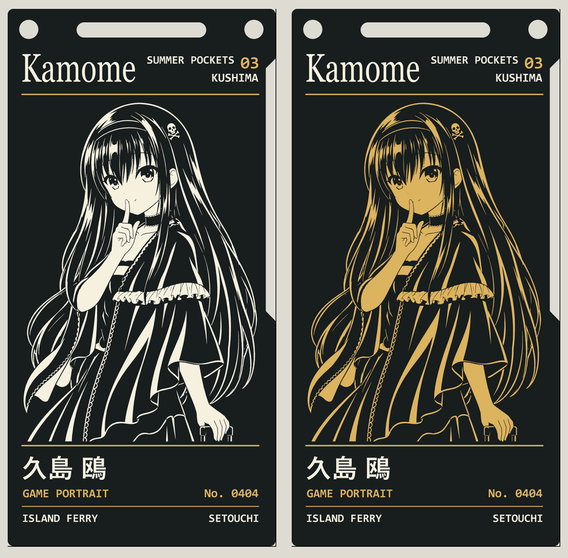

# Kamome Kushima · 0404

[简体中文](README.md) · [English](README.en.md) · [日本語](README.ja.md)

[Collection index](../../README.en.md)

**04.04**　高松 → 直島・宮浦 · あさひ

The character ID at the top right of the front is **03** across all designs and both finishes on this page.

**05 · Game Portrait**　Black and white on the left, black and gold on the right.

Designs 01–05 run left to right. The top row uses white ink for the character and the bottom row uses gold. Open a preview for the full-size board.

The white-silkscreen edition outlines Kamome’s dark hair and picks out the lit folds of her navy dress. The three scenes use gold for parasol ribs, rails and foliage to keep the figure legible.

On the gold edition of Summer Dress, black solder mask forms the shadows beneath the sleeves and inside the skirt folds. Exposed gold picks out the sleeve ruffles, waist seam and the folds spreading from Kamome’s hand. The suitcases in 03 and 04 carry gold bands, corner guards and wheels.

[Download ten Gerber sets](kamome-0404-10-gerbers.zip)

| Design | Black and white | Character in gold | Original |
| --- | --- | --- | --- |
| 01 · Summer Dress | [PNG](01/black-white/front.png) · [Project](01/black-white/kamome-0404-01-black-white.epro2) · [Gerber](01/black-white/kamome-0404-01-black-white-gerber.zip) | [PNG](01/black-gold/front.png) · [Project](01/black-gold/kamome-0404-01-black-gold.epro2) · [Gerber](01/black-gold/kamome-0404-01-black-gold-gerber.zip) | [Original](https://summerpockets-anime.jp/wp_summer/wp-content/themes/summerpocket_thema/img/chara/chara04.png) · [Black and white · Ink master](01/ink-black-white.png) / [Character in gold · Ink master](01/ink.png) |
| 02 · Under the Parasol | [PNG](02/black-white/front.png) · [Project](02/black-white/kamome-0404-02-black-white.epro2) · [Gerber](02/black-white/kamome-0404-02-black-white-gerber.zip) | [PNG](02/black-gold/front.png) · [Project](02/black-gold/kamome-0404-02-black-gold.epro2) · [Gerber](02/black-gold/kamome-0404-02-black-gold-gerber.zip) | [Original](https://key.visualarts.gr.jp/summer_rb/common/image/gallery_cg_sprb_05_l.jpg) · [Black and white · Ink master](02/ink-black-white.png) / [Character in gold · Ink master](02/ink.png) |
| 03 · Seaside Path | [PNG](03/black-white/front.png) · [Project](03/black-white/kamome-0404-03-black-white.epro2) · [Gerber](03/black-white/kamome-0404-03-black-white-gerber.zip) | [PNG](03/black-gold/front.png) · [Project](03/black-gold/kamome-0404-03-black-gold.epro2) · [Gerber](03/black-gold/kamome-0404-03-black-gold-gerber.zip) | [Original](https://key.visualarts.gr.jp/summer_rb/common/image/gallery_cg_03_l.jpg) · [Black and white · Ink master](03/ink-black-white.png) / [Character in gold · Ink master](03/ink.png) |
| 04 · Travel Trunk | [PNG](04/black-white/front.png) · [Project](04/black-white/kamome-0404-04-black-white.epro2) · [Gerber](04/black-white/kamome-0404-04-black-white-gerber.zip) | [PNG](04/black-gold/front.png) · [Project](04/black-gold/kamome-0404-04-black-gold.epro2) · [Gerber](04/black-gold/kamome-0404-04-black-gold-gerber.zip) | [Original](https://key.visualarts.gr.jp/summer_rb/common/image/gallery_cg_sprb_06_l.jpg) · [Black and white · Ink master](04/ink-black-white.png) / [Character in gold · Ink master](04/ink.png) |
| [05 · Game Portrait](05/preview.png) | [PNG](05/black-white/front.png) · [Project](05/black-white/kamome-0404-05-black-white.epro2) · [Gerber](05/black-white/kamome-0404-05-black-white-gerber.zip) | [PNG](05/black-gold/front.png) · [Project](05/black-gold/kamome-0404-05-black-gold.epro2) · [Gerber](05/black-gold/kamome-0404-05-black-gold-gerber.zip) | [Original](https://key.visualarts.gr.jp/summer_rb/common/image/character_image_kamome.png) · [Shared ink master](05/ink.png) |

## Back

## Fabrication

Extract the character bundle and upload one design’s Gerber ZIP. Use two-layer FR-4, 1.6 mm, 1 oz, black mask, white silkscreen and ENIG. All six artwork layers were checked against the native projects. Fine hair and eye detail still need a physical sample.

[Layer checks](verification.json)
