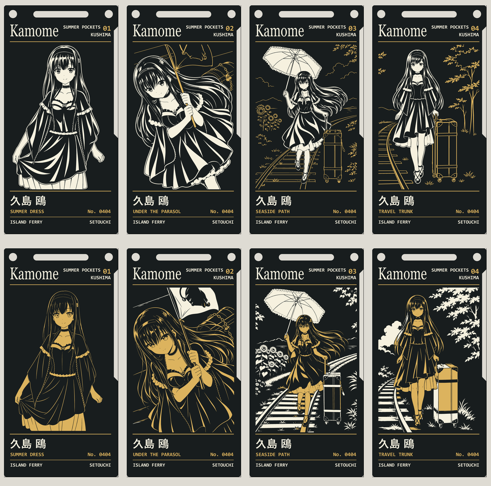

# 久島 鴎 · 0404

[简体中文](README.md) · [English](README.en.md) · [日本語](README.ja.md)

[返回总览](../../README.md)

**04.04**　高松 → 直島・宮浦 · あさひ

从左到右为 01–04 款，上排黑白，下排人物黑金。点击各款预览可查看大图。

黑白版用白丝印勾出深发与深色裙装的外缘和受光衣褶。三款场景图以沉金画背景，让伞骨、轨道和树影与人物分开。

[下载八套 Gerber](kamome-0404-8-gerbers.zip)

| 款式 | 黑白 | 人物黑金 | 原画 |
| --- | --- | --- | --- |
| 01 · 夏日洋装 | [PNG](01/black-white/front.png) · [工程](01/black-white/kamome-0404-01-black-white.epro2) · [Gerber](01/black-white/kamome-0404-01-black-white-gerber.zip) | [PNG](01/black-gold/front.png) · [工程](01/black-gold/kamome-0404-01-black-gold.epro2) · [Gerber](01/black-gold/kamome-0404-01-black-gold-gerber.zip) | [原画](https://summerpockets-anime.jp/wp_summer/wp-content/themes/summerpocket_thema/img/chara/chara04.png) · [黑白 · 线稿](01/ink-black-white.png) / [人物黑金 · 线稿](01/ink.png) |
| 02 · 黑伞下 | [PNG](02/black-white/front.png) · [工程](02/black-white/kamome-0404-02-black-white.epro2) · [Gerber](02/black-white/kamome-0404-02-black-white-gerber.zip) | [PNG](02/black-gold/front.png) · [工程](02/black-gold/kamome-0404-02-black-gold.epro2) · [Gerber](02/black-gold/kamome-0404-02-black-gold-gerber.zip) | [原画](https://key.visualarts.gr.jp/summer_rb/common/image/gallery_cg_sprb_05_l.jpg) · [黑白 · 线稿](02/ink-black-white.png) / [人物黑金 · 线稿](02/ink.png) |
| 03 · 海边小径 | [PNG](03/black-white/front.png) · [工程](03/black-white/kamome-0404-03-black-white.epro2) · [Gerber](03/black-white/kamome-0404-03-black-white-gerber.zip) | [PNG](03/black-gold/front.png) · [工程](03/black-gold/kamome-0404-03-black-gold.epro2) · [Gerber](03/black-gold/kamome-0404-03-black-gold-gerber.zip) | [原画](https://key.visualarts.gr.jp/summer_rb/common/image/gallery_cg_03_l.jpg) · [黑白 · 线稿](03/ink-black-white.png) / [人物黑金 · 线稿](03/ink.png) |
| 04 · 旅行箱 | [PNG](04/black-white/front.png) · [工程](04/black-white/kamome-0404-04-black-white.epro2) · [Gerber](04/black-white/kamome-0404-04-black-white-gerber.zip) | [PNG](04/black-gold/front.png) · [工程](04/black-gold/kamome-0404-04-black-gold.epro2) · [Gerber](04/black-gold/kamome-0404-04-black-gold-gerber.zip) | [原画](https://key.visualarts.gr.jp/summer_rb/common/image/gallery_cg_sprb_06_l.jpg) · [黑白 · 线稿](04/ink-black-white.png) / [人物黑金 · 线稿](04/ink.png) |

## 背面

## 制板

解压角色合集后，选一款 Gerber ZIP 上传嘉立创。双层 FR-4，板厚 1.6 mm，1 oz，黑阻焊、白丝印、沉金。六个图形层已与工程逐点核对，精细发丝和眼部仍需实板验证。

[图层核验](verification.json)
