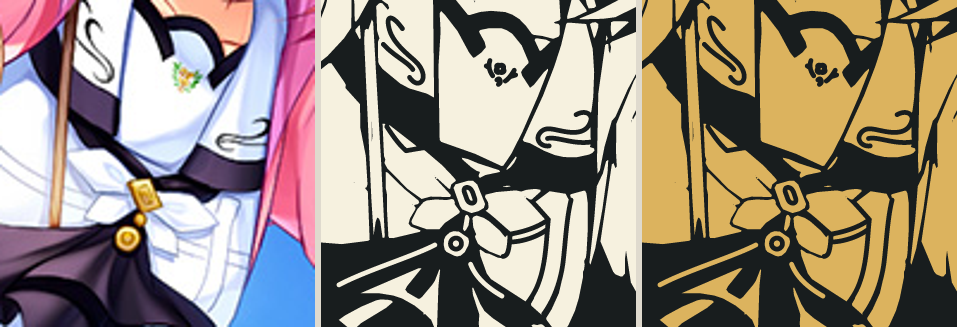

# Shiki Kamiyama · 0704

[简体中文](README.md) · [English](README.en.md) · [日本語](README.ja.md)

[Collection index](../../README.en.md)

**07.04**　高松 → 女木島 · めおん

The character ID at the top right of the front is **05** across all designs and both finishes on this page.

Designs 01–04 run left to right. The top row uses white ink for the character and the bottom row uses gold. Open a preview for the full-size board.

On the black-and-white Floating Lanterns board, the two cord knots hanging from the hood use exposed ENIG. The hood fabric, tassels, clothing and distant ridge are in black and white. The clouds, rain, lanterns, rocks and water reflections use ENIG. The black-and-gold edition uses white silkscreen for the lanterns and their reflections. On the black-and-gold Summer Leap board, the skirt panel below the pouch uses ENIG. The other black-and-white editions retain their selected gold clasps and their original sleeve, pouch, neckerchief and ribbon finishes.

[Download eight Gerber sets](shiki-0704-8-gerbers.zip)

| Design | Black and white | Character in gold | Original |
| --- | --- | --- | --- |
| 01 · Oni Hood | [PNG](01/black-white/front.png) · [Project](01/black-white/shiki-0704-01-black-white.epro2) · [Gerber](01/black-white/shiki-0704-01-black-white-gerber.zip) | [PNG](01/black-gold/front.png) · [Project](01/black-gold/shiki-0704-01-black-gold.epro2) · [Gerber](01/black-gold/shiki-0704-01-black-gold-gerber.zip) | [Original](https://key.visualarts.gr.jp/summer_rb/common/image/character_image_shiki.png) · [Ink master](01/ink.png) |
| 02 · Summer Leap | [PNG](02/black-white/front.png) · [Project](02/black-white/shiki-0704-02-black-white.epro2) · [Gerber](02/black-white/shiki-0704-02-black-white-gerber.zip) | [PNG](02/black-gold/front.png) · [Project](02/black-gold/shiki-0704-02-black-gold.epro2) · [Gerber](02/black-gold/shiki-0704-02-black-gold-gerber.zip) | [Original](https://key.visualarts.gr.jp/summer_rb/common/image/gallery_cg_sprb_15_l.jpg) · [Ink master](02/ink.png) |
| 03 · Floating Lanterns | [PNG](03/black-white/front.png) · [Project](03/black-white/shiki-0704-03-black-white.epro2) · [Gerber](03/black-white/shiki-0704-03-black-white-gerber.zip) | [PNG](03/black-gold/front.png) · [Project](03/black-gold/shiki-0704-03-black-gold.epro2) · [Gerber](03/black-gold/shiki-0704-03-black-gold-gerber.zip) | [Original](https://key.visualarts.gr.jp/summer_rb/common/image/gallery_cg_07_l.jpg) · [Ink master](03/ink.png) |
| 04 · Firelight | [PNG](04/black-white/front.png) · [Project](04/black-white/shiki-0704-04-black-white.epro2) · [Gerber](04/black-white/shiki-0704-04-black-white-gerber.zip) | [PNG](04/black-gold/front.png) · [Project](04/black-gold/shiki-0704-04-black-gold.epro2) · [Gerber](04/black-gold/shiki-0704-04-black-gold-gerber.zip) | [Original](https://key.visualarts.gr.jp/summer_rb/common/image/gallery_cg_sprb_16_l.jpg) · [Ink master](04/ink.png) |

[Both cord knots at matching scale (official CG above, Gerber artwork below)](02/knot-reference.png) · [Original CG by Key](https://key.visualarts.gr.jp/summer_rb/common/image/gallery_cg_sprb_15_l.jpg)

[Both ENIG hood knots on the black-and-white Floating Lanterns board](03/hood-knots.png)

The distant lanterns appear as points of light. The nearer ones have visible paper folds and short reflections, and the large foreground lanterns cast broader trails across the water.

The original is rotated to the angle used on the ticket. The middle and right columns are rendered from their respective Gerber files.

The hand study uses a crop of the official CG. The near fingertips curl into the palm, and the rear fingers meet the upper edge of the knee. [View the ImageGen ink study](04/grip-study.png)

## Back

The loading ramp, open vehicle deck and bridge windows follow the operator’s photograph of *Meon*. The ship’s red stripes are picked out in exposed gold.

[Ferry close-up](meon-detail.png) · [Layered vector artwork](meon.svg) · [Operator’s photograph](https://meon.co.jp/common/img/page/ship-img21.jpg)

## Fabrication

Extract the character bundle and upload one design’s Gerber ZIP. Use two-layer FR-4, 1.6 mm, 1 oz, black mask, white silkscreen and ENIG. All six artwork layers were checked against the native projects. Fine hair and eye detail still need a physical sample.

[Layer checks](verification.json)
