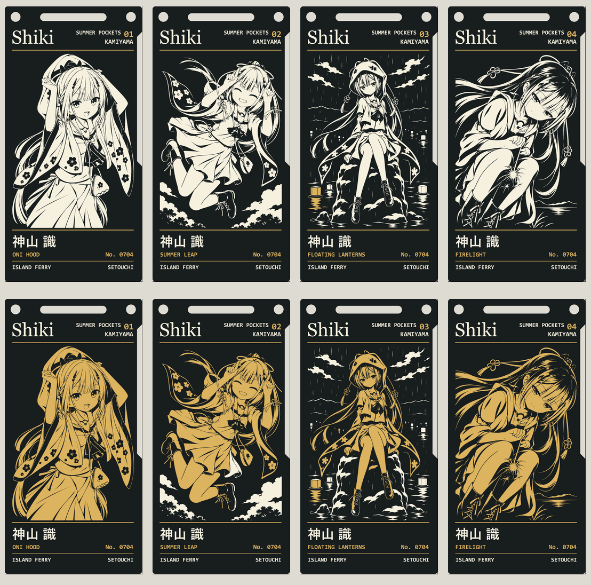
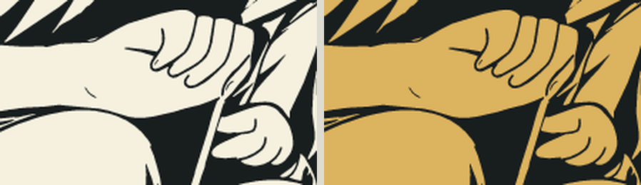

# Shiki Kamiyama · 0704

[简体中文](README.md) · [English](README.en.md) · [日本語](README.ja.md)

[Collection index](../../README.en.md)

**07.04**　高松 → 女木島 · めおん

Designs 01–04 run left to right. The top row uses white ink for the character and the bottom row uses gold. Open a preview for the full-size board.

[Download eight Gerber sets](shiki-0704-8-gerbers.zip)

| Design | Black and white | Character in gold | Original |
| --- | --- | --- | --- |
| 01 · Oni Hood | [PNG](01/black-white/front.png) · [Project](01/black-white/shiki-0704-01-black-white.epro2) · [Gerber](01/black-white/shiki-0704-01-black-white-gerber.zip) | [PNG](01/black-gold/front.png) · [Project](01/black-gold/shiki-0704-01-black-gold.epro2) · [Gerber](01/black-gold/shiki-0704-01-black-gold-gerber.zip) | [Original](https://key.visualarts.gr.jp/summer_rb/common/image/character_image_shiki.png) · [Ink master](01/ink.png) |
| 02 · Summer Leap | [PNG](02/black-white/front.png) · [Project](02/black-white/shiki-0704-02-black-white.epro2) · [Gerber](02/black-white/shiki-0704-02-black-white-gerber.zip) | [PNG](02/black-gold/front.png) · [Project](02/black-gold/shiki-0704-02-black-gold.epro2) · [Gerber](02/black-gold/shiki-0704-02-black-gold-gerber.zip) | [Original](https://key.visualarts.gr.jp/summer_rb/common/image/gallery_cg_sprb_15_l.jpg) · [Ink master](02/ink.png) |
| 03 · Floating Lanterns | [PNG](03/black-white/front.png) · [Project](03/black-white/shiki-0704-03-black-white.epro2) · [Gerber](03/black-white/shiki-0704-03-black-white-gerber.zip) | [PNG](03/black-gold/front.png) · [Project](03/black-gold/shiki-0704-03-black-gold.epro2) · [Gerber](03/black-gold/shiki-0704-03-black-gold-gerber.zip) | [Original](https://key.visualarts.gr.jp/summer_rb/common/image/gallery_cg_07_l.jpg) · [Ink master](03/ink.png) |
| 04 · Firelight | [PNG](04/black-white/front.png) · [Project](04/black-white/shiki-0704-04-black-white.epro2) · [Gerber](04/black-white/shiki-0704-04-black-white-gerber.zip) | [PNG](04/black-gold/front.png) · [Project](04/black-gold/shiki-0704-04-black-gold.epro2) · [Gerber](04/black-gold/shiki-0704-04-black-gold-gerber.zip) | [Original](https://key.visualarts.gr.jp/summer_rb/common/image/gallery_cg_sprb_16_l.jpg) · [Ink master](04/ink.png) |

## Back

## Fabrication

Extract the character bundle and upload one design’s Gerber ZIP. Use two-layer FR-4, 1.6 mm, 1 oz, black mask, white silkscreen and ENIG. All six artwork layers were checked against the native projects. Fine hair and eye detail still need a physical sample.

[Layer checks](verification.json)
