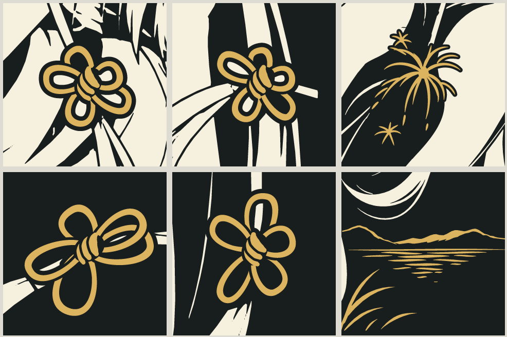
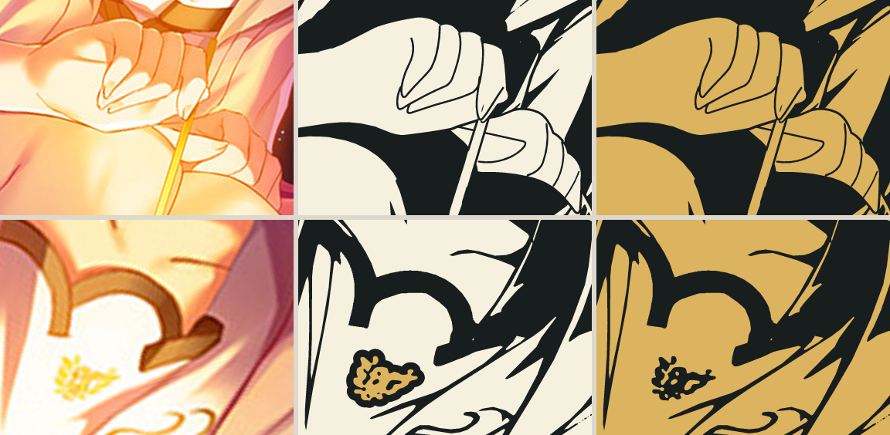

# 神山 識 · 0704

[简体中文](README.md) · [English](README.en.md) · [日本語](README.ja.md)

[総合案内へ](../../README.ja.md)

**07.04**　高松 → 女木島 · めおん

表面右上のキャラクター番号は **05** です。このページの全図柄で、白黒版・黒金版ともに共通です。

左から01〜04、上段は白黒版、下段は人物の黒金版です。各図柄のリンクから表面を拡大できます。

白黒版「浮灯」では遠山の稜線を白シルク、雲・雨・灯籠・岩・水面の映り込みを金仕上げにしています。白黒版4柄では飾り留めや髪飾りの一部に金を使い、袖の模様、ポーチ、スカーフ、リボンは元の配色を生かしています。「夏の跳躍」の黒金版は、ポーチの左下に見えるスカートの裾も金仕上げです。

[8種の Gerber 一式](shiki-0704-8-gerbers.zip)

| 図柄 | 白黒 | 人物黒金 | 原画 |
| --- | --- | --- | --- |
| 01 · 鬼のフード | [PNG](01/black-white/front.png) · [プロジェクト](01/black-white/shiki-0704-01-black-white.epro2) · [Gerber](01/black-white/shiki-0704-01-black-white-gerber.zip) | [PNG](01/black-gold/front.png) · [プロジェクト](01/black-gold/shiki-0704-01-black-gold.epro2) · [Gerber](01/black-gold/shiki-0704-01-black-gold-gerber.zip) | [原画](https://key.visualarts.gr.jp/summer_rb/common/image/character_image_shiki.png) · [線画](01/ink.png) |
| 02 · 夏の跳躍 | [PNG](02/black-white/front.png) · [プロジェクト](02/black-white/shiki-0704-02-black-white.epro2) · [Gerber](02/black-white/shiki-0704-02-black-white-gerber.zip) | [PNG](02/black-gold/front.png) · [プロジェクト](02/black-gold/shiki-0704-02-black-gold.epro2) · [Gerber](02/black-gold/shiki-0704-02-black-gold-gerber.zip) | [原画](https://key.visualarts.gr.jp/summer_rb/common/image/gallery_cg_sprb_15_l.jpg) · [線画](02/ink.png) |
| 03 · 灯籠 | [PNG](03/black-white/front.png) · [プロジェクト](03/black-white/shiki-0704-03-black-white.epro2) · [Gerber](03/black-white/shiki-0704-03-black-white-gerber.zip) | [PNG](03/black-gold/front.png) · [プロジェクト](03/black-gold/shiki-0704-03-black-gold.epro2) · [Gerber](03/black-gold/shiki-0704-03-black-gold-gerber.zip) | [原画](https://key.visualarts.gr.jp/summer_rb/common/image/gallery_cg_07_l.jpg) · [線画](03/ink.png) |
| 04 · 線香花火 | [PNG](04/black-white/front.png) · [プロジェクト](04/black-white/shiki-0704-04-black-white.epro2) · [Gerber](04/black-white/shiki-0704-04-black-white-gerber.zip) | [PNG](04/black-gold/front.png) · [プロジェクト](04/black-gold/shiki-0704-04-black-gold.epro2) · [Gerber](04/black-gold/shiki-0704-04-black-gold-gerber.zip) | [原画](https://key.visualarts.gr.jp/summer_rb/common/image/gallery_cg_sprb_16_l.jpg) · [線画](04/ink.png) |

## 裏面

船首のランプ、開放式の車両甲板、操舵室の窓は「めおん」の実船写真をもとに描きました。実船の赤いしま模様を基板では金で表現しています。

[船の拡大図](meon-detail.png) · [レイヤー別のベクター図](meon.svg) · [雌雄島海運の実船写真](https://meon.co.jp/common/img/page/ship-img21.jpg)

## 基板製造

一式を展開し、注文する図柄の Gerber ZIP を1個アップロードします。FR-4、2層、1.6 mm、1 oz、黒レジスト、白シルク、ENIG。6つの製造レイヤーをプロジェクトと照合しました。髪と目の細線は実物での確認が必要です。

[レイヤー検証](verification.json)
