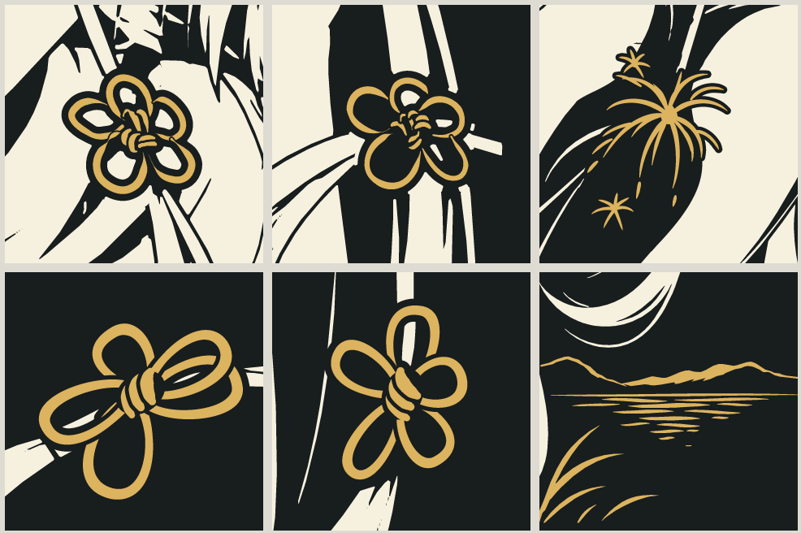
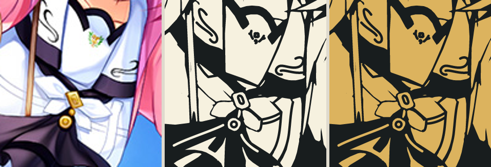
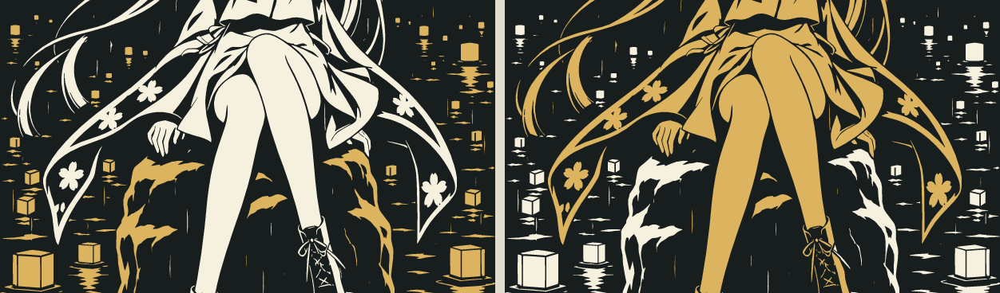
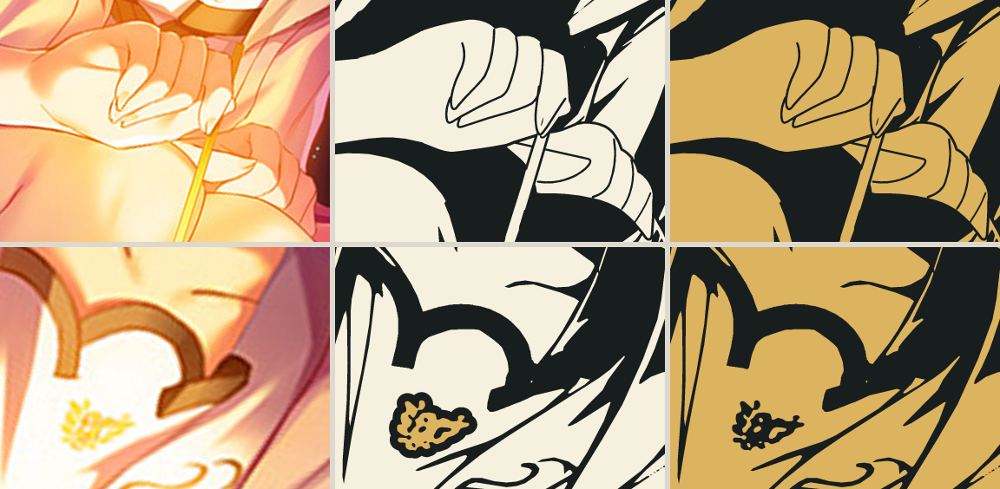
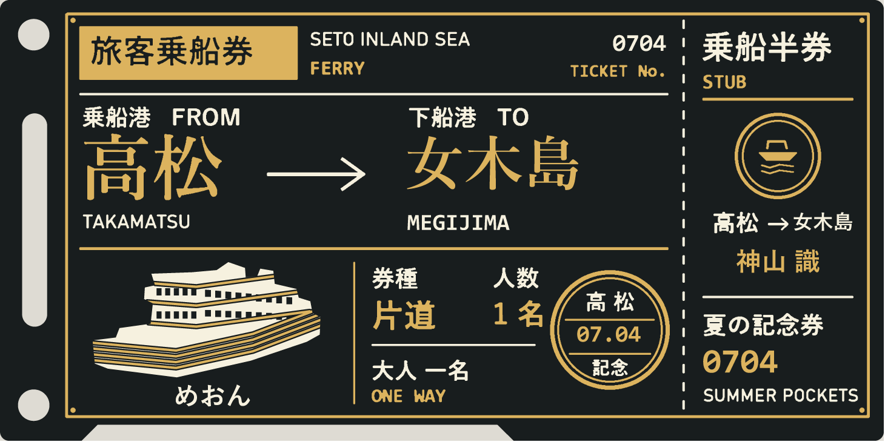

# 神山 識 · 0704

[简体中文](README.md) · [English](README.en.md) · [日本語](README.ja.md)

[返回总览](../../README.md)

**07.04**　高松 → 女木島 · めおん

正面右上角的角色编号是 **05**，本页所有插画和两种配色都使用这个编号。

从左到右为 01–04 款，上排黑白，下排人物黑金。点击各款预览可查看大图。

「浮灯」黑白版的兜帽左右各有一枚沉金花结，兜帽布面、流苏、衣服和远山用黑白表现，云雨、灯笼、岩石和水面倒影用沉金。黑金版的灯笼和倒影用白丝印。「夏日跃起」黑金版中，包左下方的裙摆为沉金。其余黑白款保留各自的饰扣点金和袖纹、包、领巾及丝带配色。

[下载八套 Gerber](shiki-0704-8-gerbers.zip)

| 款式 | 黑白 | 人物黑金 | 原画 |
| --- | --- | --- | --- |
| 01 · 鬼兜帽 | [PNG](01/black-white/front.png) · [工程](01/black-white/shiki-0704-01-black-white.epro2) · [Gerber](01/black-white/shiki-0704-01-black-white-gerber.zip) | [PNG](01/black-gold/front.png) · [工程](01/black-gold/shiki-0704-01-black-gold.epro2) · [Gerber](01/black-gold/shiki-0704-01-black-gold-gerber.zip) | [原画](https://key.visualarts.gr.jp/summer_rb/common/image/character_image_shiki.png) · [线稿](01/ink.png) |
| 02 · 夏日跃起 | [PNG](02/black-white/front.png) · [工程](02/black-white/shiki-0704-02-black-white.epro2) · [Gerber](02/black-white/shiki-0704-02-black-white-gerber.zip) | [PNG](02/black-gold/front.png) · [工程](02/black-gold/shiki-0704-02-black-gold.epro2) · [Gerber](02/black-gold/shiki-0704-02-black-gold-gerber.zip) | [原画](https://key.visualarts.gr.jp/summer_rb/common/image/gallery_cg_sprb_15_l.jpg) · [线稿](02/ink.png) |
| 03 · 浮灯 | [PNG](03/black-white/front.png) · [工程](03/black-white/shiki-0704-03-black-white.epro2) · [Gerber](03/black-white/shiki-0704-03-black-white-gerber.zip) | [PNG](03/black-gold/front.png) · [工程](03/black-gold/shiki-0704-03-black-gold.epro2) · [Gerber](03/black-gold/shiki-0704-03-black-gold-gerber.zip) | [原画](https://key.visualarts.gr.jp/summer_rb/common/image/gallery_cg_07_l.jpg) · [线稿](03/ink.png) |
| 04 · 线香花火 | [PNG](04/black-white/front.png) · [工程](04/black-white/shiki-0704-04-black-white.epro2) · [Gerber](04/black-white/shiki-0704-04-black-white-gerber.zip) | [PNG](04/black-gold/front.png) · [工程](04/black-gold/shiki-0704-04-black-gold.epro2) · [Gerber](04/black-gold/shiki-0704-04-black-gold-gerber.zip) | [原画](https://key.visualarts.gr.jp/summer_rb/common/image/gallery_cg_sprb_16_l.jpg) · [线稿](04/ink.png) |

[两侧花结放大（上排官方 CG，下排制板图）](02/knot-reference.png) · [Key 官方原画](https://key.visualarts.gr.jp/summer_rb/common/image/gallery_cg_sprb_15_l.jpg)

[浮灯黑白版的左右沉金花结](03/hood-knots.png)

远处的灯只露出一点光，中景渐渐看得见纸灯的折角和短倒影，近处的大灯在水上投下更宽的反光。

从左到右依次为官方 CG、黑白版和黑金版。原画局部已旋转至票面角度，两个 PCB 局部均由 Gerber 渲染。

这次用官方 CG 的手部裁图生成线稿。前手指尖向掌心弯曲，后手的指腹沿膝盖上缘收住。[查看 ImageGen 手部线稿](04/grip-study.png)

## 背面

船艏的车辆跳板、开放甲板和驾驶台舷窗依照「めおん」的实船照片绘制。实船的红色条纹在板上用沉金表现。

[船图放大](meon-detail.png) · [分层矢量图](meon.svg) · [雌雄島海運实船照片](https://meon.co.jp/common/img/page/ship-img21.jpg)

## 制板

解压角色合集后，选一款 Gerber ZIP 上传嘉立创。双层 FR-4，板厚 1.6 mm，1 oz，黑阻焊、白丝印、沉金。六个图形层已与工程逐点核对，精细发丝和眼部仍需实板验证。

[图层核验](verification.json)
