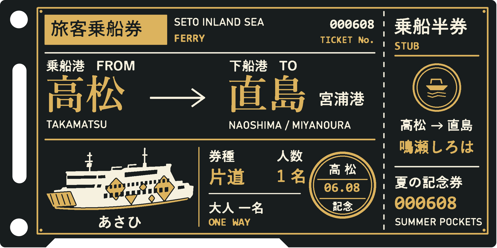

# Shiroha Naruse · Birthday Ferry Tickets

[简体中文](README.md) · [English](README.en.md) · [日本語](README.ja.md)

[Collection index](../../README.en.md)

**06.08 · 0608**　高松 → 直島・宮浦 · あさひ

The character ID at the top right of the front is **01** across all designs and both finishes on this page.

Each pair shows the character in white on the left and gold on the right. Open a design name for a larger preview.

[Download 18 Gerber sets](shiroha-0608-18-gerbers.zip)

| Design and preview | Black and white | Character in gold |
| --- | --- | --- |
| [Game portrait](game/preview.png) | [Project](game/black-white/game.epro2) · [Gerber](game/black-white/gerber.zip) | [Project](game/black-gold/game.epro2) · [Gerber](game/black-gold/gerber.zip) |
| [Blue sky](blue-sky/preview.png) | [Project](blue-sky/black-white/blue-sky.epro2) · [Gerber](blue-sky/black-white/gerber.zip) | [Project](blue-sky/black-gold/blue-sky.epro2) · [Gerber](blue-sky/black-gold/gerber.zip) |
| [Golden fan](golden-fan/preview.png) | [Project](golden-fan/black-white/golden-fan.epro2) · [Gerber](golden-fan/black-white/gerber.zip) | [Project](golden-fan/black-gold/golden-fan.epro2) · [Gerber](golden-fan/black-gold/gerber.zip) |
| [Riverside close-up](riverside-close/preview.png) | [Project](riverside-close/black-white/riverside-close.epro2) · [Gerber](riverside-close/black-white/gerber.zip) | [Project](riverside-close/black-gold/riverside-close.epro2) · [Gerber](riverside-close/black-gold/gerber.zip) |
| [Riverside medium shot](riverside-medium/preview.png) | [Project](riverside-medium/black-white/riverside-medium.epro2) · [Gerber](riverside-medium/black-white/gerber.zip) | [Project](riverside-medium/black-gold/riverside-medium.epro2) · [Gerber](riverside-medium/black-gold/gerber.zip) |
| [Riverside wide shot](riverside-wide/preview.png) | [Project](riverside-wide/black-white/riverside-wide.epro2) · [Gerber](riverside-wide/black-white/gerber.zip) | [Project](riverside-wide/black-gold/riverside-wide.epro2) · [Gerber](riverside-wide/black-gold/gerber.zip) |
| [Anime portrait](anime/preview.png) | [Project](anime/black-white/anime.epro2) · [Gerber](anime/black-white/gerber.zip) | [Project](anime/black-gold/anime.epro2) · [Gerber](anime/black-gold/gerber.zip) |
| [Fishing](02/preview.png) · [Ink master](02/ink.png) | [Project](02/black-white/shiroha-0608-02-black-white.epro2) · [Gerber](02/black-white/shiroha-0608-02-black-white-gerber.zip) | [Project](02/black-gold/shiroha-0608-02-black-gold.epro2) · [Gerber](02/black-gold/shiroha-0608-02-black-gold-gerber.zip) |
| [Underwater](04/preview.png) · [Ink master](04/ink.png) | [Project](04/black-white/shiroha-0608-04-black-white.epro2) · [Gerber](04/black-white/shiroha-0608-04-black-white-gerber.zip) | [Project](04/black-gold/shiroha-0608-04-black-gold.epro2) · [Gerber](04/black-gold/shiroha-0608-04-black-gold-gerber.zip) |

## Ticket backs

Game portrait, blue sky, golden fan, the three riverside views and anime portrait

Fishing and underwater

[Blue Sky 1007 special](../../blue-sky-1007/README.en.md)

## Fabrication notes

Extract the character bundle and upload one design’s Gerber ZIP. Use two-layer FR-4, 1.6 mm, 1 oz, black mask, white silkscreen and ENIG. All six artwork layers were checked against the native projects. Fine hair and eye detail still need a physical sample.

[Board checks](verification.json) · [Fabrication notes](../../FABRICATION.md) · [Art sources](../art-sources.json)
