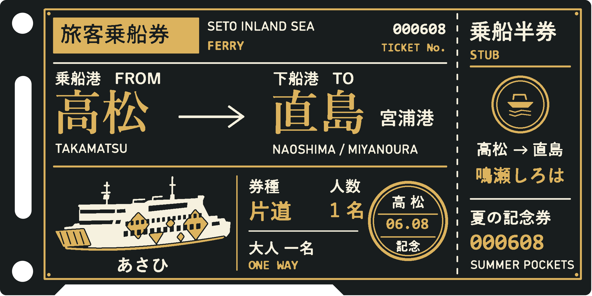

# 鸣濑白羽 · 生日船票

[简体中文](README.md) · [English](README.en.md) · [日本語](README.ja.md)

[返回总览](../../README.md)

**06.08 · 0608**　高松 → 直島・宮浦 · あさひ

正面右上角的角色编号是 **01**，本页所有插画和两种配色都使用这个编号。

每款左侧为人物黑白，右侧为人物黑金。点击款名可放大预览。

[下载 18 套 Gerber](shiroha-0608-18-gerbers.zip)

| 款式与预览 | 人物黑白 | 人物黑金 |
| --- | --- | --- |
| [游戏立绘](game/preview.png) | [工程](game/black-white/game.epro2) · [Gerber](game/black-white/gerber.zip) | [工程](game/black-gold/game.epro2) · [Gerber](game/black-gold/gerber.zip) |
| [蓝天](blue-sky/preview.png) | [工程](blue-sky/black-white/blue-sky.epro2) · [Gerber](blue-sky/black-white/gerber.zip) | [工程](blue-sky/black-gold/blue-sky.epro2) · [Gerber](blue-sky/black-gold/gerber.zip) |
| [金扇](golden-fan/preview.png) | [工程](golden-fan/black-white/golden-fan.epro2) · [Gerber](golden-fan/black-white/gerber.zip) | [工程](golden-fan/black-gold/golden-fan.epro2) · [Gerber](golden-fan/black-gold/gerber.zip) |
| [林间近景](riverside-close/preview.png) | [工程](riverside-close/black-white/riverside-close.epro2) · [Gerber](riverside-close/black-white/gerber.zip) | [工程](riverside-close/black-gold/riverside-close.epro2) · [Gerber](riverside-close/black-gold/gerber.zip) |
| [林间中景](riverside-medium/preview.png) | [工程](riverside-medium/black-white/riverside-medium.epro2) · [Gerber](riverside-medium/black-white/gerber.zip) | [工程](riverside-medium/black-gold/riverside-medium.epro2) · [Gerber](riverside-medium/black-gold/gerber.zip) |
| [林间全景](riverside-wide/preview.png) | [工程](riverside-wide/black-white/riverside-wide.epro2) · [Gerber](riverside-wide/black-white/gerber.zip) | [工程](riverside-wide/black-gold/riverside-wide.epro2) · [Gerber](riverside-wide/black-gold/gerber.zip) |
| [动画立绘](anime/preview.png) | [工程](anime/black-white/anime.epro2) · [Gerber](anime/black-white/gerber.zip) | [工程](anime/black-gold/anime.epro2) · [Gerber](anime/black-gold/gerber.zip) |
| [垂钓](02/preview.png) · [线稿](02/ink.png) | [工程](02/black-white/shiroha-0608-02-black-white.epro2) · [Gerber](02/black-white/shiroha-0608-02-black-white-gerber.zip) | [工程](02/black-gold/shiroha-0608-02-black-gold.epro2) · [Gerber](02/black-gold/shiroha-0608-02-black-gold-gerber.zip) |
| [水下凝望](04/preview.png) · [线稿](04/ink.png) | [工程](04/black-white/shiroha-0608-04-black-white.epro2) · [Gerber](04/black-white/shiroha-0608-04-black-white-gerber.zip) | [工程](04/black-gold/shiroha-0608-04-black-gold.epro2) · [Gerber](04/black-gold/shiroha-0608-04-black-gold-gerber.zip) |

## 背板

游戏立绘、蓝天、金扇、林间三景、动画立绘

垂钓、水下凝望

[蓝天 1007 特别版](../../blue-sky-1007/README.md)

## 制造说明

解压角色合集后，选一款 Gerber ZIP 上传嘉立创。双层 FR-4，板厚 1.6 mm，1 oz，黑阻焊、白丝印、沉金。六个图形层已与工程逐点核对，精细发丝和眼部仍需实板验证。

[逐款核验](verification.json) · [制造说明](../../FABRICATION.md) · [原画出处](../art-sources.json)
