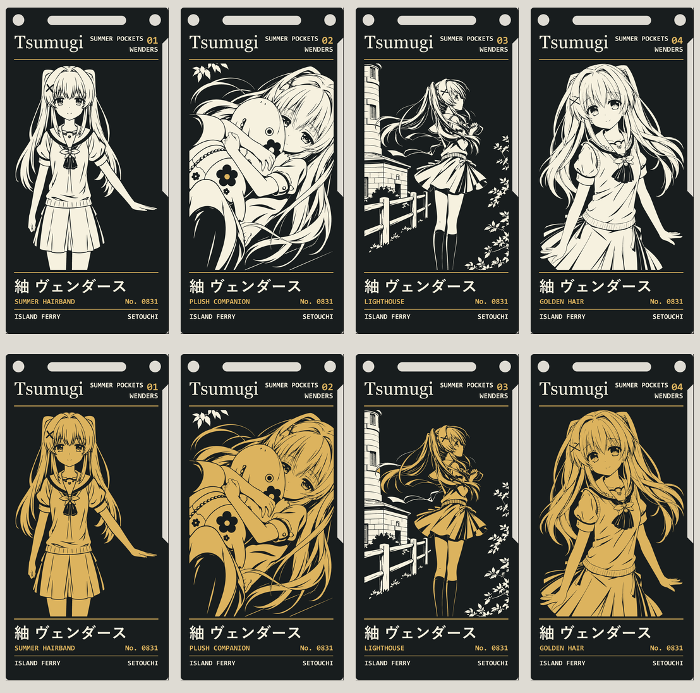
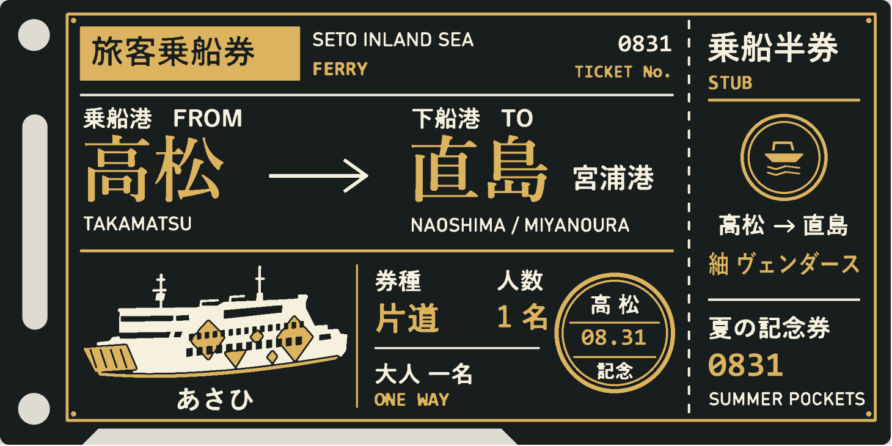

# 紬 ヴェンダース · 0831

[简体中文](README.md) · [English](README.en.md) · [日本語](README.ja.md)

[返回总览](../../README.md)

**08.31**　高松 → 直島・宮浦 · あさひ

从左到右为 01–04 款，上排黑白，下排人物黑金。点击各款预览可查看大图。

[下载八套 Gerber](tsumugi-0831-8-gerbers.zip)

| 款式 | 黑白 | 人物黑金 | 原画 |
| --- | --- | --- | --- |
| 01 · 夏日发饰 | [PNG](01/black-white/front.png) · [工程](01/black-white/tsumugi-0831-01-black-white.epro2) · [Gerber](01/black-white/tsumugi-0831-01-black-white-gerber.zip) | [PNG](01/black-gold/front.png) · [工程](01/black-gold/tsumugi-0831-01-black-gold.epro2) · [Gerber](01/black-gold/tsumugi-0831-01-black-gold-gerber.zip) | [原画](https://summerpockets-anime.jp/wp_summer/wp-content/themes/summerpocket_thema/img/chara/chara05.png) · [线稿](01/ink.png) |
| 02 · 怀中玩偶 | [PNG](02/black-white/front.png) · [工程](02/black-white/tsumugi-0831-02-black-white.epro2) · [Gerber](02/black-white/tsumugi-0831-02-black-white-gerber.zip) | [PNG](02/black-gold/front.png) · [工程](02/black-gold/tsumugi-0831-02-black-gold.epro2) · [Gerber](02/black-gold/tsumugi-0831-02-black-gold-gerber.zip) | [原画](https://key.visualarts.gr.jp/summer_rb/common/image/gallery_cg_sprb_07_l.jpg) · [线稿](02/ink.png) |
| 03 · 灯塔 | [PNG](03/black-white/front.png) · [工程](03/black-white/tsumugi-0831-03-black-white.epro2) · [Gerber](03/black-white/tsumugi-0831-03-black-white-gerber.zip) | [PNG](03/black-gold/front.png) · [工程](03/black-gold/tsumugi-0831-03-black-gold.epro2) · [Gerber](03/black-gold/tsumugi-0831-03-black-gold-gerber.zip) | [原画](https://key.visualarts.gr.jp/summer_rb/common/image/gallery_cg_04_l.jpg) · [线稿](03/ink.png) |
| 04 · 金色长发 | [PNG](04/black-white/front.png) · [工程](04/black-white/tsumugi-0831-04-black-white.epro2) · [Gerber](04/black-white/tsumugi-0831-04-black-white-gerber.zip) | [PNG](04/black-gold/front.png) · [工程](04/black-gold/tsumugi-0831-04-black-gold.epro2) · [Gerber](04/black-gold/tsumugi-0831-04-black-gold-gerber.zip) | [原画](https://key.visualarts.gr.jp/summer_rb/common/image/character_image_wenders.png) · [线稿](04/ink.png) |

## 背面

## 制板

解压角色合集后，选一款 Gerber ZIP 上传嘉立创。双层 FR-4，板厚 1.6 mm，1 oz，黑阻焊、白丝印、沉金。六个图形层已与工程逐点核对，精细发丝和眼部仍需实板验证。

[图层核验](verification.json)
