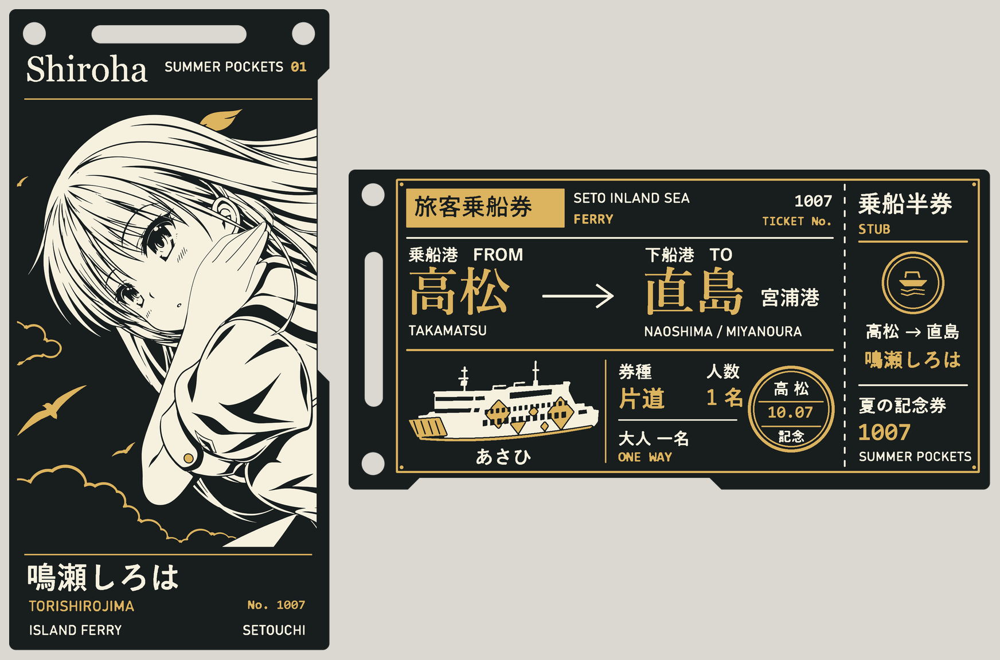
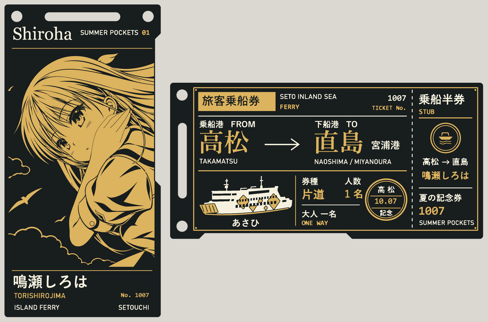

# Shiroha Naruse · Blue Sky 1007

[简体中文](README.md) · [English](README.en.md) · [日本語](README.ja.md)

Ticket **1007** appears on the front, the back ticket header and the stub. The postmark reads **October 7 (10.07)**. This edition is based on the v1.3.4 Blue Sky design.

[Download the 1007 bundle](../blue-sky-1007/Blue-Sky-1007-All.zip)

To order a board, upload the Gerber ZIP for your chosen color variant.

## Black and white

[EasyEDA Pro project](../blue-sky-1007/Blue-Sky-1007-Black-White.epro2) · [Gerber ZIP](../blue-sky-1007/Blue-Sky-1007-Black-White-Gerber.zip)

## Black and gold

[EasyEDA Pro project](../blue-sky-1007/Blue-Sky-1007-Black-Gold.epro2) · [Gerber ZIP](../blue-sky-1007/Blue-Sky-1007-Black-Gold-Gerber.zip)

[All nine Shiroha designs](../birthday-tickets/shiroha/README.en.md)

## References and acknowledgments

This project references [observer0703's Kurisu ENIG PCB](https://github.com/observer0703/-kurisu-enig-pcb), specifically [v1.0.0, including its project files and manufacturing guide](https://github.com/observer0703/-kurisu-enig-pcb/releases/tag/v1.0.0). Thank you to the author for sharing the project and production experience.

The board shape, lanyard holes and slot, and base project are reused from that reference. Its use of black solder mask, white silkscreen and ENIG gold also informed the material-layer presentation. The Shiroha artwork, lettering, and front and back ferry-ticket layouts were redesigned on that basis. See the [source notice (Chinese)](../NOTICE.md) for the scope of rights covering the upstream design and character materials.

Another related reference is [adenzhou1350's ENIG PCB Art collection](https://github.com/adenzhou1350/enig-pcb-art), which brings together black-and-gold PCB artwork, material-layer documentation, project build tools and reproduction guides. Thank you to the author for sharing these designs and production resources.

## Sources and license

The original ferry-ticket layout, layer artwork and PCB modifications created for this project are licensed under CERN-OHL-P-2.0. Character and source-art rights remain with their respective rights holders. [Sources and scope (Chinese)](../NOTICE.md) · [License](../LICENSE)
