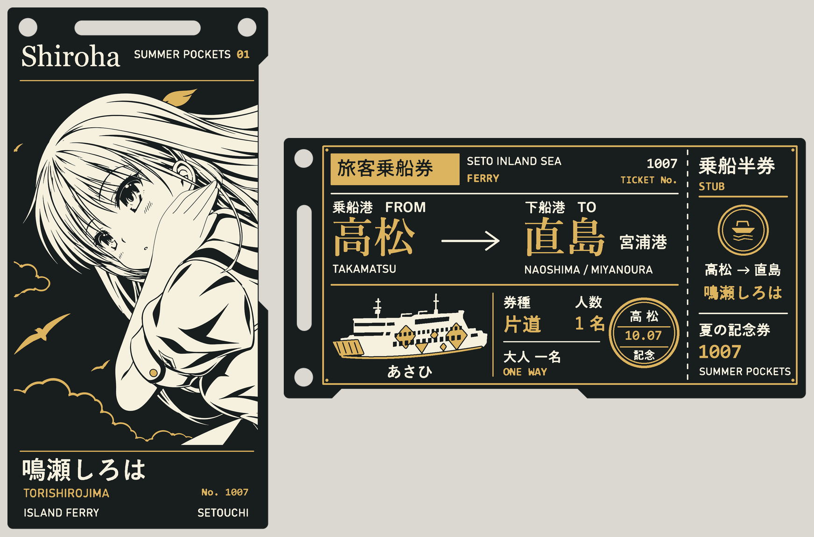
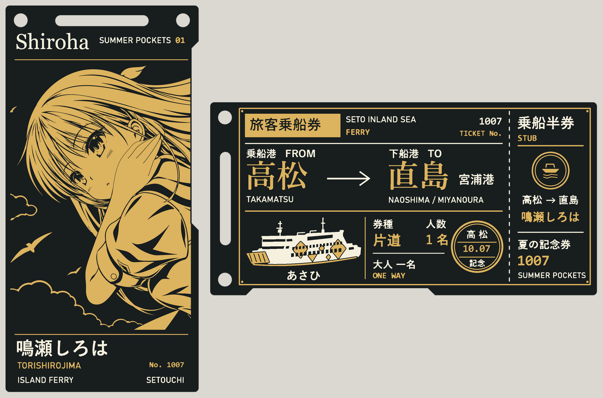

# 鳴瀬しろは · 青空 1007 記念版

[简体中文](README.md) · [English](README.en.md) · [日本語](README.ja.md)

表面、裏面の券面上部、半券の券番号は **1007** です。裏面の記念印の日付は **10 月 7 日（10.07）** です。v1.3.4 の青空デザインをもとに制作しました。

[1007 版一式をダウンロード](../blue-sky-1007/Blue-Sky-1007-All.zip)

発注時は、お好みの配色の Gerber ZIP をアップロードしてください。

## 白黒版

[EasyEDA Pro プロジェクト](../blue-sky-1007/Blue-Sky-1007-Black-White.epro2) · [Gerber ZIP](../blue-sky-1007/Blue-Sky-1007-Black-White-Gerber.zip)

## 黒金版

[EasyEDA Pro プロジェクト](../blue-sky-1007/Blue-Sky-1007-Black-Gold.epro2) · [Gerber ZIP](../blue-sky-1007/Blue-Sky-1007-Black-Gold-Gerber.zip)

[通常版の全 7 種を見る](../shiroha-classic/README.ja.md)

## 参考プロジェクト・謝辞

本プロジェクトは [observer0703 氏の牧瀬紅莉栖 ENIG PCB（Kurisu ENIG PCB）](https://github.com/observer0703/-kurisu-enig-pcb) を参考にしています。参照した版は [v1.0.0（プロジェクトファイルと製造ガイド）](https://github.com/observer0703/-kurisu-enig-pcb/releases/tag/v1.0.0) です。設計データや制作ノウハウの公開に感謝します。

基板の形状、ストラップ用の穴・スロット、ベースとなるプロジェクトは、参照元のプロジェクトを引き継いでいます。黒ソルダーレジスト、白シルク、ENIG 金めっきを使ったレイヤー表現も参考にしました。鳴瀬しろはの人物図柄、文字、表裏のフェリーチケットのレイアウトは、その上で新たに設計しています。参照元の設計とキャラクター素材の権利範囲は、[出典に関する説明（中国語）](../NOTICE.md) をご覧ください。

関連する参考資料として、[adenzhou1350 氏の ENIG PCB Art · 黒と金の PCB 作品集](https://github.com/adenzhou1350/enig-pcb-art) も紹介します。このリポジトリには、黒と金の PCB 作品、材料別のレイヤー構成、プロジェクトのビルドツール、再製作の手順がまとめられています。設計と制作資料の公開に感謝します。

## 出典とライセンス

本プロジェクトで独自に作成したフェリーチケットのレイアウト、レイヤー図柄、PCB の変更部分は CERN-OHL-P-2.0 で公開しています。キャラクターと原画の権利は、それぞれの権利者に帰属します。[出典と適用範囲（中国語）](../NOTICE.md) · [ライセンス](../LICENSE)
