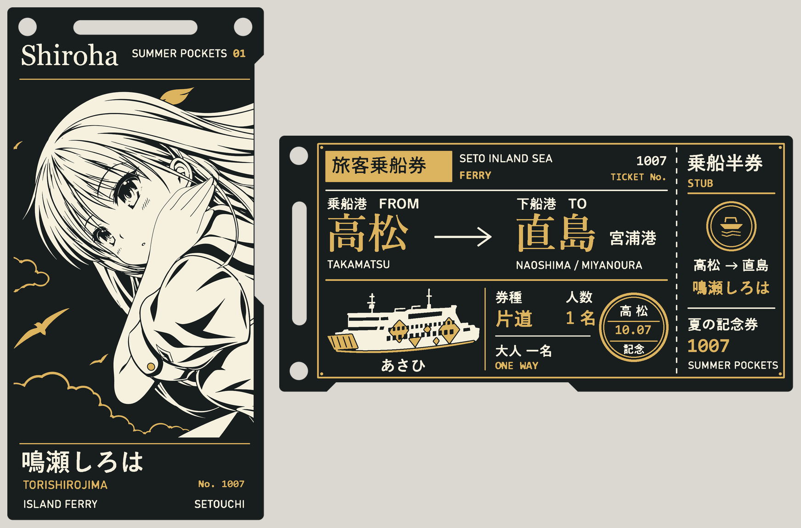
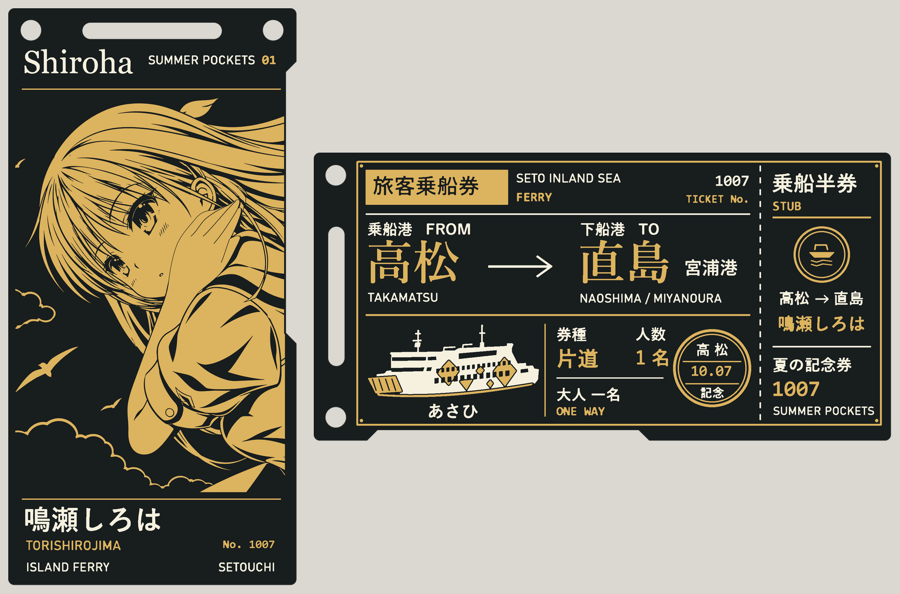

# 鸣濑白羽 · 蓝天 1007 纪念版

[简体中文](README.md) · [English](README.en.md) · [日本語](README.ja.md)

正面、背面票头及票根的票号均为 **1007**，背面纪念章日期为 **10 月 7 日（10.07）**。本版基于 v1.3.4 蓝天款。

[下载 1007 完整包](../blue-sky-1007/Blue-Sky-1007-All.zip)

打板时，按配色上传对应的 Gerber ZIP。

## 黑白版

[嘉立创 EDA 工程](../blue-sky-1007/Blue-Sky-1007-Black-White.epro2) · [Gerber ZIP](../blue-sky-1007/Blue-Sky-1007-Black-White-Gerber.zip)

## 黑金版

[嘉立创 EDA 工程](../blue-sky-1007/Blue-Sky-1007-Black-Gold.epro2) · [Gerber ZIP](../blue-sky-1007/Blue-Sky-1007-Black-Gold-Gerber.zip)

[白羽全部九款](../birthday-tickets/shiroha/README.md)

## 参考项目与致谢

本项目参考了 [observer0703 的牧濑红莉栖沉金 PCB（Kurisu ENIG PCB）](https://github.com/observer0703/-kurisu-enig-pcb)，使用的参考版本为 [v1.0.0（工程文件与制板说明）](https://github.com/observer0703/-kurisu-enig-pcb/releases/tag/v1.0.0)。感谢作者公开工程与制作经验。

板形、挂绳孔槽与底板工程沿用该参考工程，并参考其黑色阻焊、白色丝印与沉金的图层表现方式。鸣濑白羽人物图形、文字和正反面船票版式在此基础上重新设计。上游设计与角色素材的权利范围见 [来源说明](../NOTICE.md)。

相关参考还包括 [adenzhou1350 的 ENIG PCB Art · 黑金 PCB 作品集](https://github.com/adenzhou1350/enig-pcb-art)。该仓库整理了黑金 PCB 作品、材料分层、工程构建工具与复刻流程，感谢作者公开设计与制作资料。

## 来源与许可

本项目原创的船票版式、分层制图和 PCB 修改采用 CERN-OHL-P-2.0。角色与原画的权利归各自权利人。[来源及范围](../NOTICE.md) · [许可证](../LICENSE)
